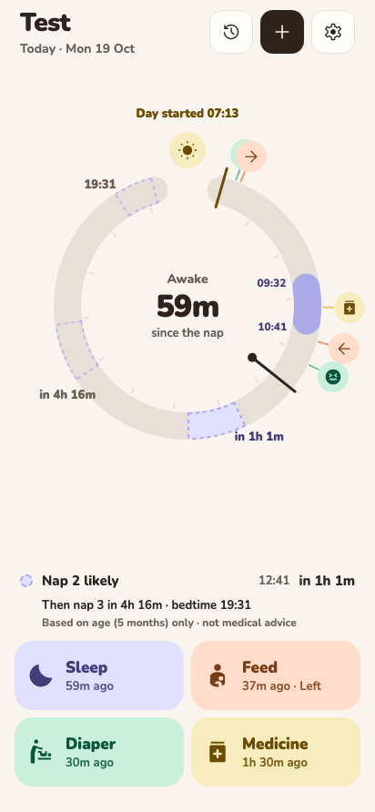
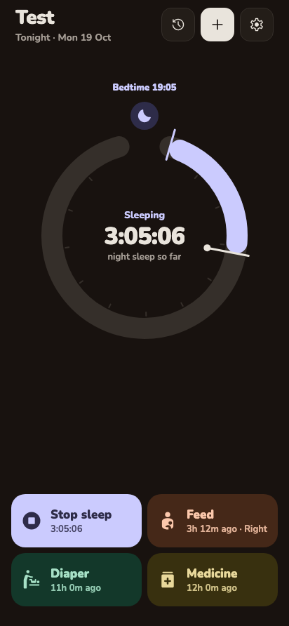
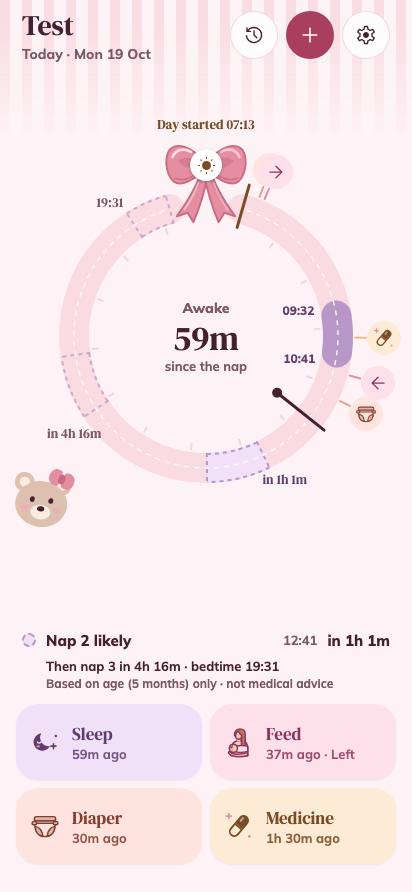

# Molly

A fast, one-handed front end for [Baby Buddy](https://github.com/babybuddy/babybuddy), the self-hosted baby tracker. Log sleep, feeds, diaper changes and medicine in one tap, see the baby's day as a clock ring, and keep both parents in step through your Baby Buddy, with nothing else to host. Molly runs as a web app, an Android app, Android home-screen widgets and a lock-screen notification for running timers.

<p>
  
  
  
</p>

<sub>Screenshots use made-up test data.</sub>

## Features

- **One-tap logging** for sleep (timed), feeds (logged at once, or timed), diaper changes and medicine, with Adjust time and Undo right after.
- **The day as a ring**: from morning wake to bedtime, then the night. Naps, feeds, changes and medicine sit at their own times; Recent days shows earlier days the same way.
- **Next likely sleep**: while the baby is awake, when the next nap or bedtime is likely, from the baby's age and the last two weeks of sleeps. Skip a nap and the rest of the day moves.
- **Android widgets and lock-screen notification**: start and stop sleeps and log feeds without opening the app. Live Updates on Android 16.
- **Day and night from the child's rhythm**: Molly learns when each child usually wakes and goes to bed, so an early wake starts the day and an evening catnap stays a nap. Saved to Baby Buddy as nap or night sleep.
- **Two or three children**, each with their own colour, day and night starting times, default bottle and widgets.
- **Measurements**: weight against the WHO bands, height, head circumference, temperature and BMI.
- **Development guide**: what many children do at each age, with sources (Sweden or international).
- **Themes**: eight looks, from the plain Molly Classic to Arcade, Ribbon and Life Sim, each in day and night.

## How it works

You host [Baby Buddy](https://github.com/babybuddy/babybuddy) yourself (Docker, a Raspberry Pi, a NAS…); Molly adds **no backend** of its own. The web app, the Android app, its widgets and its notification all talk straight to your Baby Buddy over its REST API with a Baby Buddy API key. The simplest setup is one Baby Buddy user shared by both parents. Parents share state only through Baby Buddy: a sleep started on one phone shows on the other at the next refresh, and either can stop it.

```
 phone A ─┐
 phone B ─┼──► your Baby Buddy (REST API)
 browser ─┘
```

Nothing is sent anywhere else. See [`SECURITY.md`](SECURITY.md) for what each device stores.

## Quick start

You need a running Baby Buddy (v2.11 or later) and its API key: both parents can sign in with the same admin user, so there are no permissions to set up. [`docs/setup.md`](docs/setup.md) covers users and permissions (including separate users per parent), CORS for the web app, Cloudflare Tunnel and Access, and troubleshooting.

**Web app** (an nginx image built from this repo, needs Docker):

```sh
pnpm install
echo 'BABY_BUDDY_ORIGIN=https://baby.example.com' > docker/.env
pnpm web:up          # http://localhost:8080
pnpm web:image:pi    # or: an arm64 image tarball (e.g. for a Raspberry Pi) in dist/
```

**Android app, ready-made:** download `molly-<version>.apk` from the [latest release](https://github.com/alfredskeden/molly/releases/latest) on your phone, open it and allow installing from your browser when Android asks. To update, install the newer APK from a later release over it; your login and settings stay. These builds are signed by the project's author and install as `se.skedeback.molly`.

**Android app, your own build** (built locally, no Play Store, no EAS): create your own signing key and build with `pnpm android:release`, step by step in [`docs/android-build.md`](docs/android-build.md). Expo Go can't run Molly: the widgets need native code.

## Requirements

- Node 24+ and pnpm 10 (`corepack enable`)
- Docker, for the web image and the test Baby Buddy
- For Android builds: JDK 17 and the Android SDK (platform 36, build-tools 36, NDK 27.1) on macOS or Linux; setup in [`docs/android-build.md`](docs/android-build.md)

## Development

```sh
pnpm install
pnpm bb:up && pnpm bb:seed   # disposable Baby Buddy v2.11.0 on :4778 with test users
pnpm check                   # boundaries + typecheck + lint + all tests + web-bundle check
pnpm e2e                     # Playwright against the web image
pnpm bb:down
```

| Path | What |
| --- | --- |
| `apps/molly` | Expo app (Android + web). Routes in `src/app/`, Android widgets in `src/widget/*.android.tsx` |
| `apps/molly/modules/molly-notify` | Local Expo module (Kotlin) for the lock-screen notification |
| `packages/api` | Typed Baby Buddy client. No React |
| `packages/core` | Pure domain logic (predictions, the ring, totals…). No I/O |
| `e2e` | Playwright specs, the test Baby Buddy (docker compose) and its seed |
| `docker` | nginx web image |
| `docs` | Setup and Android build |
| `plans` | How every feature was planned and built ([`plans/README.md`](plans/README.md)) |

[`CONTRIBUTING.md`](CONTRIBUTING.md) has the conventions; [`CLAUDE.md`](CLAUDE.md) is the architecture guide.

## Not medical advice

Sleep predictions are estimates from the baby's age and recent sleeps. The development guide and growth bands are general information from public health sources. Neither replaces your child health nurse, doctor or midwife. When something worries you, ask them.

## Status

A personal project that one family uses every day. Issues and pull requests are welcome, but there's no support promise. Molly is not affiliated with Baby Buddy.

## License

MIT, see [`LICENSE`](LICENSE). The WHO growth tables and other third-party content keep their own licenses: see [`THIRD_PARTY.md`](THIRD_PARTY.md).
