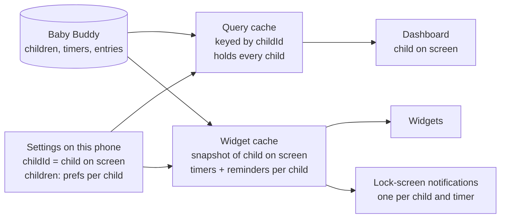
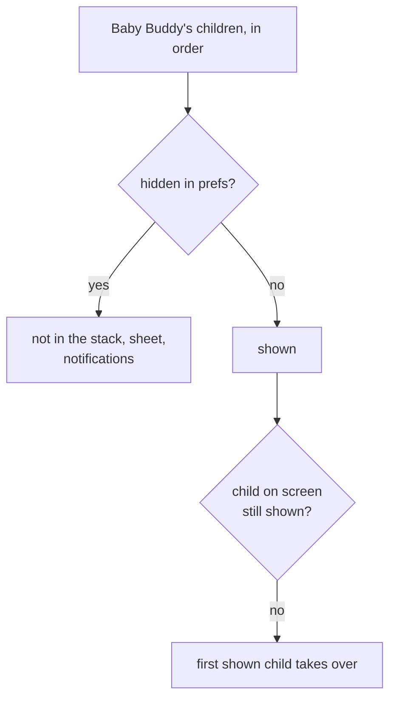
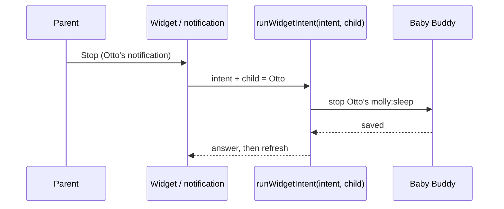

# More than one child: mental model

## In one line

One child on screen at a time; swipe the avatar stack to move on, tap it to pick. Everything else (widgets, lock screen, reminders) always knows which child it's about.

## The dashboard

```
┌──────────────────────────────────┐
│ Ella                    (M)(O)   │  ← stack: shown child in front,
│ 5 months · Mon 28 Sep      (E)   │     up to two behind
│ ┌──────────────────────────────┐ │
│ │ (O) Otto is sleeping · 42m [Switch]│  ← only when another child sleeps
│ └──────────────────────────────┘ │
│  hero · Today · tiles · Recent   │  ← all Ella's, as today
└──────────────────────────────────┘
```

- **Pull down** on the stack: the front avatar shrinks away and the next comes forward. Past halfway it switches on release, and the toast says "Showing Otto".
- **Tap** the stack: the Children sheet opens (a row per child with "Sleeping 42m" / "Awake 1h 25m", then Manage children and Settings).
- **One child**: a single avatar, no pull, and tap still opens the sheet.

## Where things live



- **Per child** (on the child's own screen): shown or hidden, colour, nap window, bottle defaults, Vitamin D reminder.
- **Shared** ("For every child"): theme, lock-screen timer, haptics.
- Name and birth date come from Baby Buddy. Molly never edits them.

## Which children show



- A new child in Baby Buddy appears shown, with the next colour.
- The last shown child can't be hidden.
- Onboarding: "Which children?" with all ticked. The unticked ones are saved hidden. One child skips the step.

## Taps always hit the right child



- **Widget**: shows the app's child on screen, with a badge when several are shown. A tap acts on the child it drew.
- **Notification**: each carries its child in the action. Two sleeping children means two notifications, "Ella · Sleeping" and "Otto · Sleeping".
- **Vitamin D reminder**: per child, and only after a stop of that child with its switch on.

## With one child

Same as today plus the avatar: no strip, no badge, and no names in the notifications.
