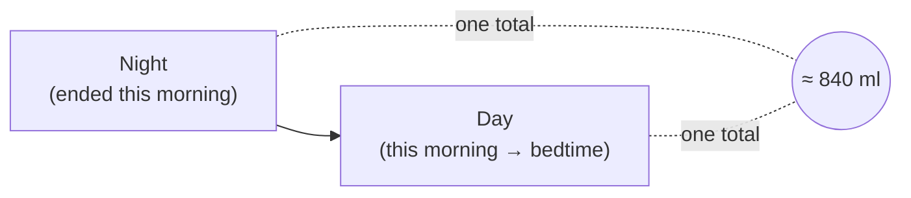
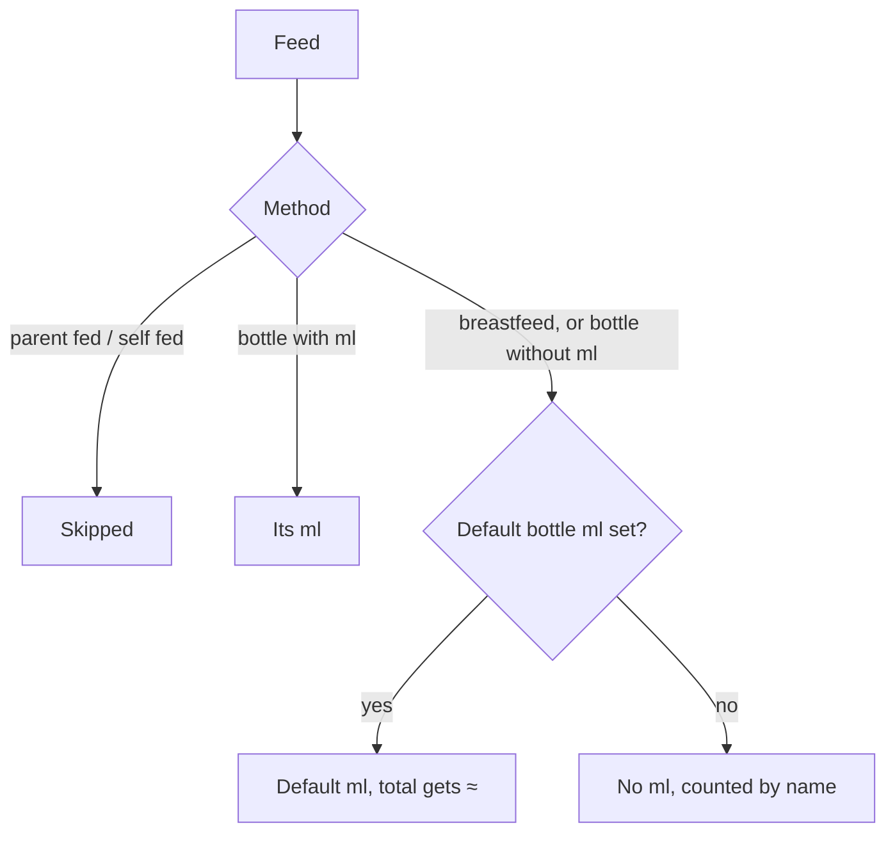
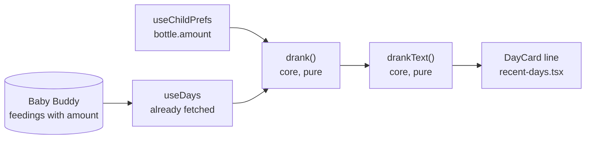

# Mental model: daily ml total

## In one line

Each Recent days card shows about how much the baby drank from one morning to the next: measured bottles plus a default-sized guess per breastfeed.

## The span

A card is one morning: the night that ended on it, then the day after.

A feed belongs to the card it **started** in. The live `Tonight` card totals the night so far.

## What each feed adds

The default is the child's bottle amount on this phone today. Change it and past estimates change too.

## What the card says

| Feeds on the card | Line |
| --- | --- |
| None | nothing |
| Only bottles with ml | `640 ml` |
| Any estimate | `≈ 840 ml` |
| No default, breastfeeds | `360 ml + 3 breastfeeds` |
| No default, a bottle without ml too | `360 ml + 4 feeds without ml` |

Screen readers hear "about" for `≈` and "millilitres" for `ml`.

## Where the pieces live

Nothing new is fetched or saved. Only Recent days shows it.
