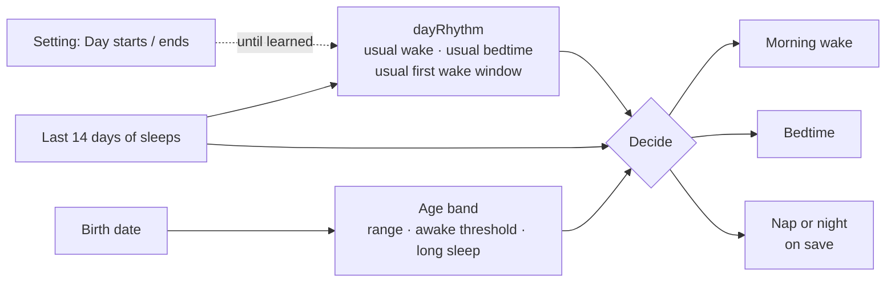
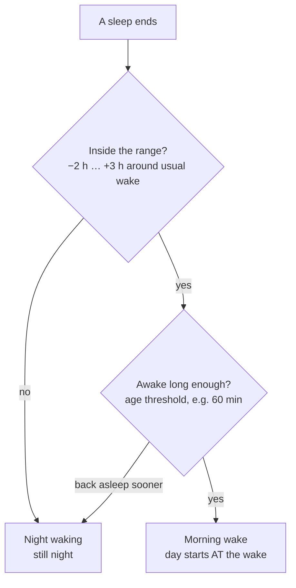
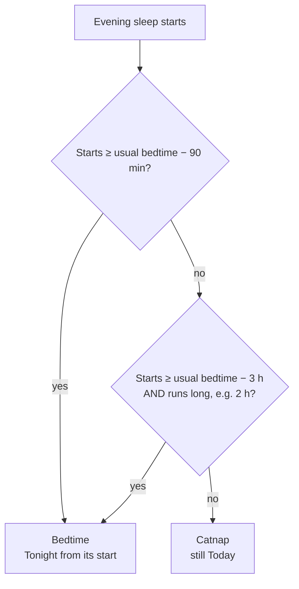
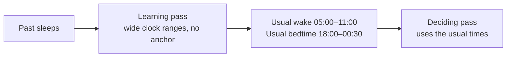
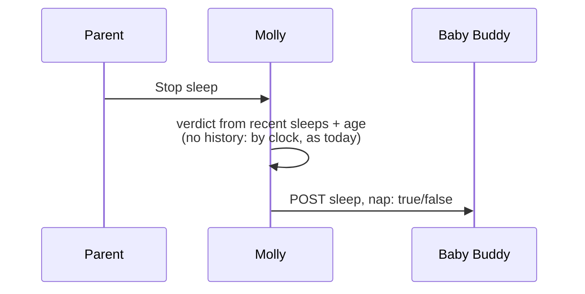

# Day and night: mental model

## The one idea

Molly stops asking "what time is it?" and starts asking "what does **this child** usually do, and what did they just do?".



Nothing is stored. All three outputs are recomputed whenever they're needed.

## What goes wrong today

One fixed window (default 07:00–19:00) does every job:

| Case | Today | Should be |
| --- | --- | --- |
| Woke 06:31, up 1 h 44 min, slept 08:15–10:26 | Night runs to **10:26**, the sleep saved as night | Day from **06:31**, the sleep is a nap |
| 25 min sleep at 19:30, usual bedtime ~21:45 | Flips to Tonight, saved as night | A catnap: still Today, saved as nap |

## Morning: two checks

A sleep that ends after a night is the morning wake only if **both** pass.



Narrow before the usual wake, wide after it. A 05:00 waking stays night; a late wake after a bad night still counts.

## Morning, live

```
05:10  wakes ─ 20 min ─ asleep        → night waking (under threshold)
06:31  wakes ─────────────────────────┐
07:31  threshold passed               │ ring flips to Today,
       Today starts at 06:31 ◄────────┘ start set back to the wake
08:15  asleep → a nap of today
```

For the first hour the ring still shows night. That's the price of not guessing.

## Bedtime: start or length

After the morning wake, the first sleep that is the night:



While it runs, the card stays Today until one check passes. Once it's the night, a waking an hour later doesn't undo it.

## The child's numbers



Two passes on purpose: if the decisions taught themselves, the usual wake could creep later each day until it chose lunch naps. Fewer than 3 days learned: the setting's "Day starts / Day ends" stands in.

## Age changes the numbers

| Age | Awake at least | Long evening sleep |
| --- | --- | --- |
| under 3 months | 75 min (no learned wake: range from "Day starts") | 3 h |
| 3–6 months | 60 min | 2 h |
| 6–12 months | 45 min | 2 h |
| 12 months + | 40 min | 2 h |

Young babies have long early wakings; older ones have short night wakings and long wake windows. The threshold is never more than ⅔ of the child's usual first wake window. These are starting values, tuned with replay.

## Saving the flag



Decided once, at stop or log. Never patched later, so the other parent's view doesn't change behind their back.

## Who feels it

Ring and Today card · Recent days and the Today sheet · next-sleep prediction and day plan · needs layer · widgets · lock-screen "saves as nap / night sleep" · the saved flag · Vitamin D cycle · replay.

Unchanged: development stats, weeks and History stay on calendar days.

## The setting

"Day starts / Day ends" stays, but means **starting values**: used until Molly has learned the child, for babies under 3 months, and as the clock fallback.
