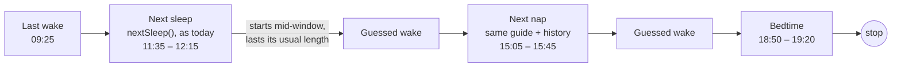
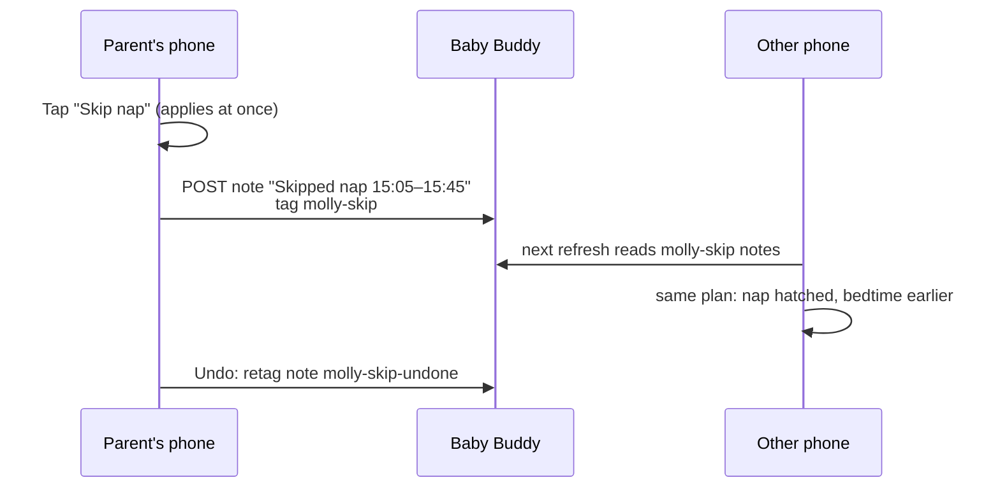
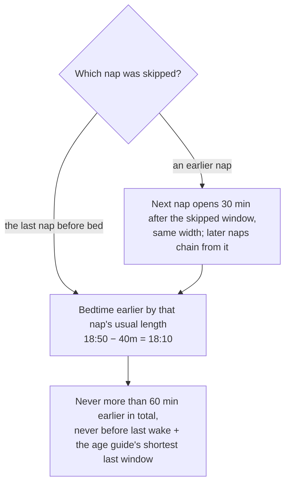
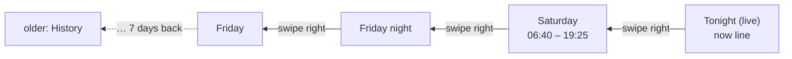
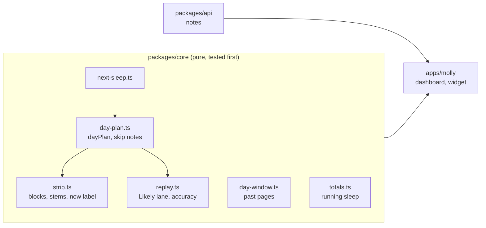

# Day plan: the mental model

## In one line

The Today strip now shows **every likely sleep until bedtime**, labelled where each one starts. The card can **swipe back** through the last 7 days, and a nap can be **skipped** in one tap, which reworks the rest of the day on both phones.

The hero, Recent and the widgets still show only the next sleep.

## What changes where

| Place | Before | After |
|---|---|---|
| Today strip | the next sleep as a dashed block, a 3-hour time grid, a 19:00 marker | every likely sleep until bedtime; a time on a stem at each sleep start; one label for "now" under the strip |
| Tonight strip | start, hour and end labels | only the "now" label |
| Sleep total | finished sleeps only (`0m sleep` while asleep) | includes the sleep still running, rising live |
| Today card | the current day only | swipes back through 7 days of days and nights |
| Hero | the next sleep | the same, plus `Skip nap` / `Undo skip` |
| Recent, widgets | the next sleep | the same, but they follow skips |

## How the rest of the day is guessed



The first sleep is exactly what the hero shows now. Each later one assumes the sleep before it **starts mid-window** and lasts that slot's **usual length** (the median over 14 days, else 45 min), then predicts from that guessed wake. The chain stops at bedtime.

Each step builds on a guess, so later sleeps are less certain. That's why they are **drawn as outlines**, while the next one keeps its filled dashed block. Nothing is stored: a logged nap recomputes everything after it.

## Reading the strip

```
          08:40        11:35           15:05          18:50
            |            ┆               ┆               ┆|
 Sleep  [███]       [▒▒▒▒▒▒]        [┄┄┄┄┄┄]        [┄┄┄┄┄┄]
 Feed      ▮  ▮           │
 Diaper        •          │
                        10:50
```

- **Grey, solid stem**: where a logged sleep started. **Violet, dashed stem**: where a likely one starts. Bedtime's stem sits on the right of its label so the label stays inside the card.
- **Filled dashed block** (`▒`): the next sleep. **Outline** (`┄`): later ones. **Hatched**: a skipped nap, with no stem.
- **Under the strip**: only the time now, riding the now line and kept inside the strip at either end. Nothing else uses that row, so nothing covers it.
- If two stem labels would overlap, one is dropped: a logged one before a likely one.
- The strip ends at the **end of the bedtime window** (or now + 30 min, if later).

Tonight has no stems at all, just the now label.

## Skipping a nap



Baby Buddy has no "skipped nap" entry, so the skip is a **note** with the tag `molly-skip`. It's readable in Baby Buddy's own web app. Undo **changes the tag** instead of deleting the note, because parents aren't allowed to delete notes.

A skip lasts **until the next sleep of 15 min or more starts**. A sleep inside the skipped window simply counts as that nap. Bedtime can't be skipped.

## How a skip reworks the day



The last wake stays the starting point: the skipped window just counts as more time awake. The numbers (30, 45, 60 min) are the design's starting guesses.

After a skip the hero says `Bedtime likely 18:10 – 18:40` with `Nap 15:05 skipped · bedtime was 18:50` and `Undo skip`. A toast offers `Undo` too.

## Swiping back



Only the **card** moves. The hero, tiles and Recent stay live, so looking back never hides what's happening now. `Back to now ›` returns, and the card snaps back by itself after 60 s or when the app comes back from the background.

A past day shows:
- **Sleep** (what happened) with a **Likely** lane under it (what Molly expected). Each likely window is the last one Molly would have shown just before that sleep started, rebuilt from the logs. Skipped naps show hatched.
- One line of accuracy: `3 of 3 naps started in the likely window · bedtime 5m after`.
- Stems on each logged sleep start and bedtime. No now line.

## The sleep total

`2h 40m sleep` counts **every sleep in the card's window up to now, including the one still running**. Tonight counts from bedtime, so at 22:43 with the baby asleep since 19:30 it reads `3h 13m sleep` and keeps rising. It starts again at 0 when the next window begins (the morning wake, then the next bedtime).

## Where the code lives



The rules live in `packages/core` and are built test-first; the app only draws them. The replay script (`pnpm replay:naps`) also checks how often the later, chained sleeps turn out right on real logs.
