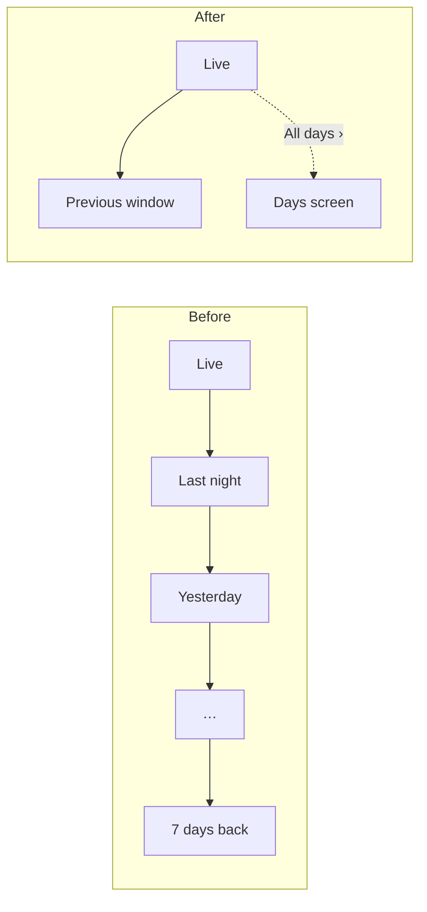
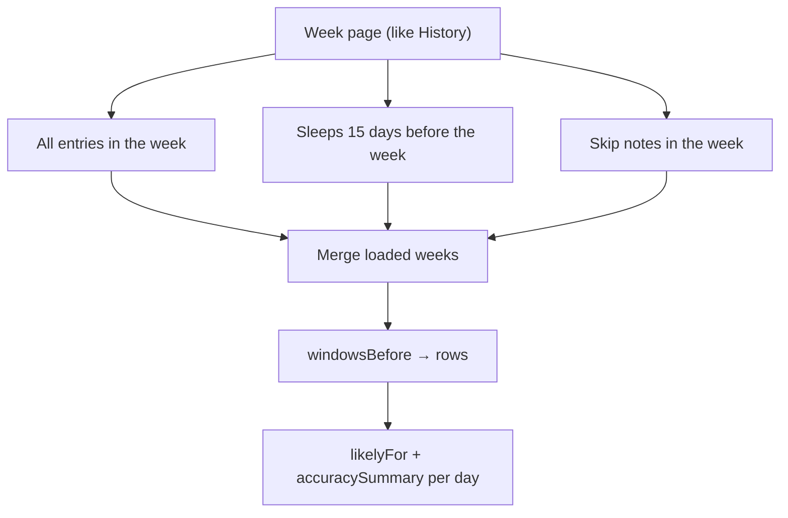

# Days: the picture

Two changes. The Today card looks back **one step**. Everything older goes to a new **Days** screen.

## Before and after



Before, the card swiped through 14 pages. Now it has two, and the Days screen holds the rest.

## Which window is "previous"

Always the window just before the live one. Days and nights alternate.

| Live page | One swipe right shows |
| --- | --- |
| Today (after the morning wake) | Last night |
| Tonight, evening | Today's day, just ended |
| Tonight, after midnight | Yesterday's day |

The past page looks the same as before: strip, stems, Likely lane and accuracy line on a day, `Back to now ›`, snapping back after a minute.

## The Days screen

A scrolling list of past-page cards, with no live window.

```
‹ Back
Days
┌ Saturday night 26 September · 19:25 – 06:50 ┐   ← last finished window
│ totals · strip                              │
└─────────────────────────────────────────────┘
┌ Saturday 26 September · 06:40 – 19:25       ┐
│ totals · strip · Likely lane                │
│ 3 of 3 naps started in the likely window …  │
└─────────────────────────────────────────────┘
┌ Friday night 25 September …                 ┐
   …
[ Load earlier ]                                  ← one more week
```

- Newest first, with one row per day and one per night.
- Days show what Molly expected (Likely lane, accuracy line). Nights don't.
- Titles carry the date, because weekdays repeat.
- Read-only: no taps, no filters. Edits stay in History.

## Where the data comes from



- Nothing new is stored. Everything is worked out on the device from logs, as before.
- The 15 days of earlier sleeps are there because the Likely lane replays what Molly would have predicted, and a prediction uses two weeks of history.
- Skip notes need a new `date_max` filter so an older week fetches only its own notes.

## One card, two places

The past-window card is built inline in the dashboard today. It moves into one shared component, which the swipe page and each Days row both render. The swipe page adds `Back to now ›` in the header slot. The live card puts `All days ›` there instead.

## Order of work

1. `previousWindow` in core (unit TDD).
2. `date_max` on notes (api integration test).
3. One swipe, the shared card, the `All days ›` link (Playwright).
4. Days screen (Playwright).
5. Wrap up the docs.
