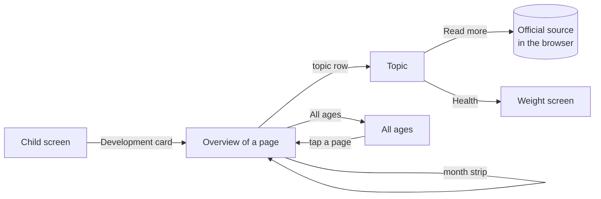
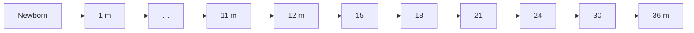
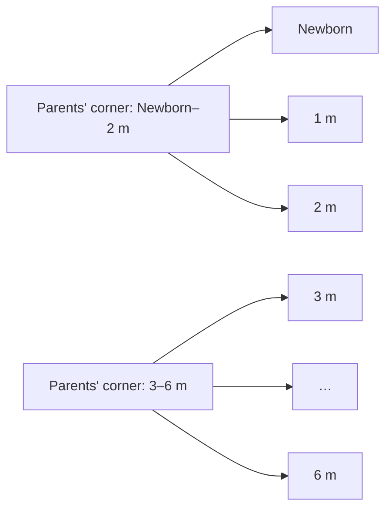
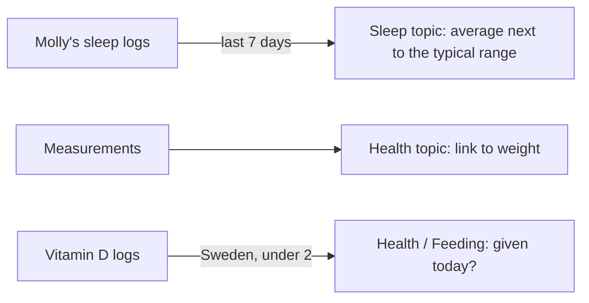

# Development guide: the picture

Full plan in [`MAIN.md`](MAIN.md), sources in [`NOTES.md`](NOTES.md).

## In one line

An offline age guide, birth to 3 years, inside each child's screen: what many children do now, what to try, when to get help, and where to read more.

## Where it sits

The guide opens on the child's own page. Browsing changes the page, never the child.

## Pages

19 pages: monthly in the first year, then every 3 months, then every 6. A child is on the last page they've reached. After 3 years the card says the guide has ended.

## What a page holds

Every page has the same 8 topics:

Movement · Sounds and talking · Sleep · Feeding · Play and senses · Feelings and social · Health · Parents' corner

Each topic has:
- a headline and intro
- many children around now
- try together
- when to get help
- read more

Every claim links back to an official source.

## One text, many pages

Writing doesn't happen page by page. A topic's text covers a range of pages, and each page uses the one that covers its age.

So text only changes where children really change.

## Region swaps a few parts

One setting on the phone: **Sweden** (the default) or **International**. Most text is shared, and the region only swaps these parts:

| Part | Sweden | International |
| --- | --- | --- |
| Check-ups | BVC visit around this age | What many countries check, local programme |
| Vaccines | Swedish programme (6 wk, 3, 5, 12, 18 m) | WHO tables, local programme |
| Food | Tiny tastes from 4 m at the earliest, D-drops to 2 y | Solids around 6 m, ask about vitamin D |
| Get help | BVC, 1177, 112 | Doctor or nurse, local emergency number |
| Read more | 1177, Rikshandboken, Livsmedelsverket first | WHO, CDC, NHS first |

## The child's own data

Sleep shows numbers only, never "too little" or "too much", and only once 3 full days are logged.

## Safety first

- "Not medical advice" on every screen.
- A "when to get help" box in every topic, with the right contacts.
- A one-time note the first time the guide opens.
- Wording says "many children", never "should".
- All text is our own words. Sources are credited and linked, never copied, and no logos are used.

## Where the code goes

| Part | Place |
| --- | --- |
| Pages, content, sources, rules | `packages/core/src/development/` (pure, tested) |
| Region and first-open flag | `Settings` in `apps/molly/src/storage/types.ts` |
| Screens | `src/app/(main)/child/[id]/development/` |
| Link check | `pnpm check:sources` |
