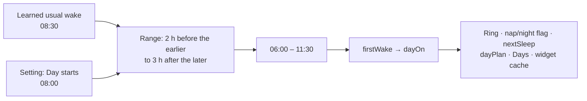
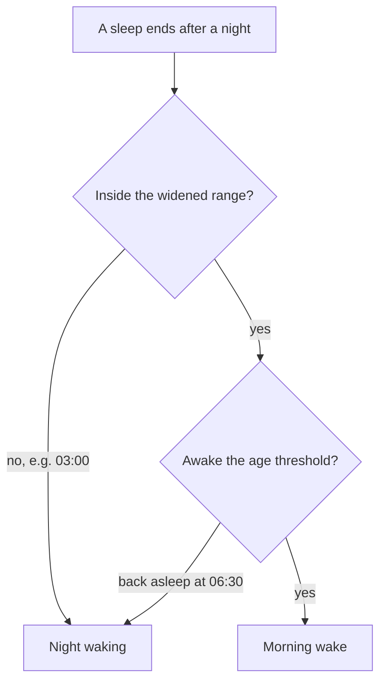
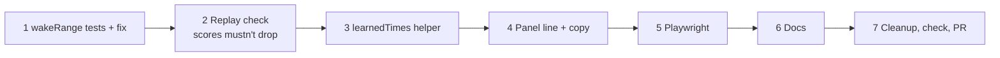

# Early morning wake: mental model

## The one idea

The morning wake may fall near **either** the learned usual wake **or** the parent's "Day starts". Today only the learned one counts once it's learned.



One function changes (`wakeRange` in `day-window.ts`). Everything downstream follows on its own.

## What goes wrong today

"Day starts" 08:00, learned wake 08:30. Range is built from the learned wake only: **06:30–11:30**.

```
22:42  bedtime
06:03  wakes ── outside 06:30–11:30 → night waking, however long
07:05  still awake, ring still says Tonight
08:38  asleep → "night sleep so far", no nap prediction, saved as night
```

## After the fix

Range is the hull of both: **06:00–11:30**.

```
06:03  wakes ── inside the range
07:03  threshold (60 min) passed → ring flips to Today, from 06:03
08:38  asleep → the day's first nap, saved nap: true
```

The day still waits for the awake threshold, then starts at the wake (backdated). Same as before.

## The range, three cases

| Learned wake | Day starts | Today | New |
| --- | --- | --- | --- |
| 08:30 | 08:00 | 06:30–11:30 | **06:00**–11:30 |
| 07:00 | 08:00 | 05:00–10:00 | 05:00–**11:00** |
| not learned (= setting) | 07:00 | 05:00–10:00 | unchanged |

A learned wake later than the setting widens the start; earlier widens the end.

## Night wakings stay the night



Only the first check changes. The second (threshold) is untouched.

## What doesn't change

- **Learning.** `dayRhythm` still learns from a fixed 05:00–11:00 range, so the learned wake can't drift because of this.
- **Bedtime.** "Day ends" doesn't widen anything.
- **Under 3 months.** The setting already is the wake.

## What the parent sees

The child screen's "Day and night" panel gets one line:

| Learned | Line |
| --- | --- |
| both | Molly has learned: wakes about 08:30, bed about 21:45 |
| one | only that one |
| none, or sleeps not loaded | Still learning |

Under 3 months the wake is never shown (the setting is the wake). The explainer says a morning wake near either time counts. Sleeps come from `useGuideEntries` (already cached on that screen); a small core helper turns the rhythm into clock strings.

## Order of work



Step 2 is the gate: if a made-up profile's score drops, stop and bring the numbers back before tuning.
