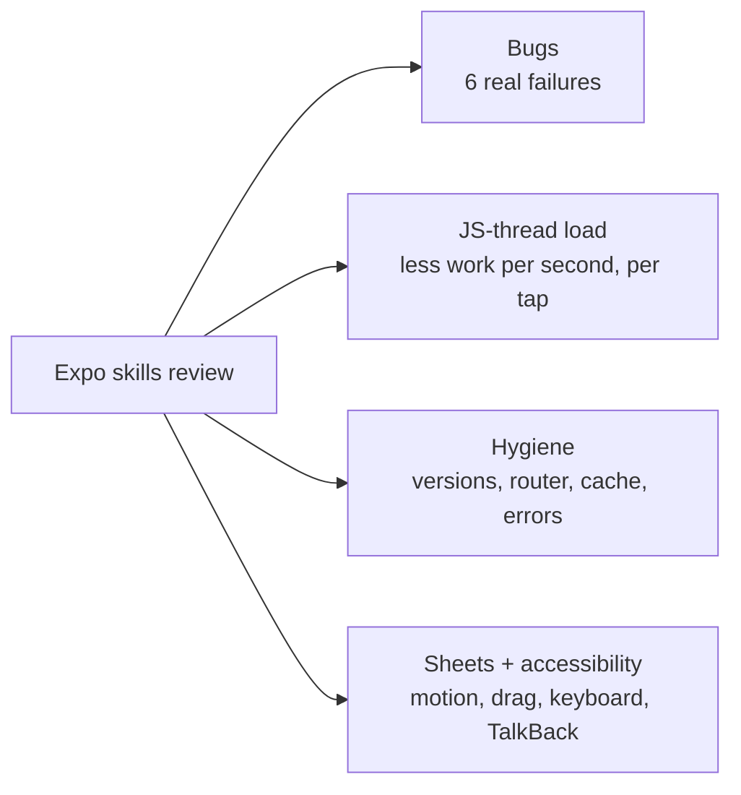
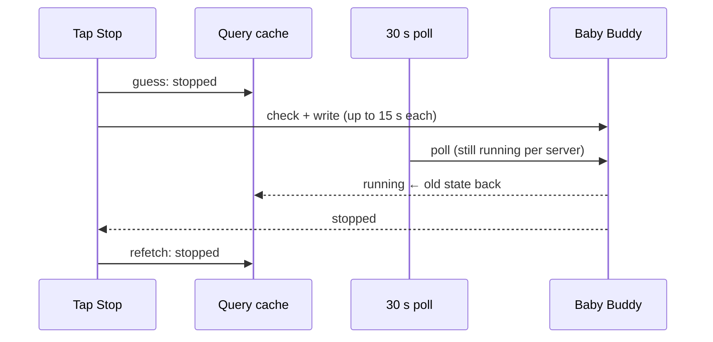
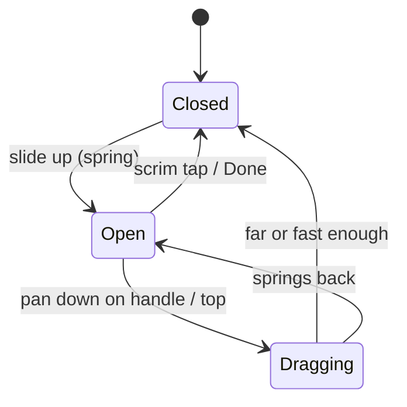
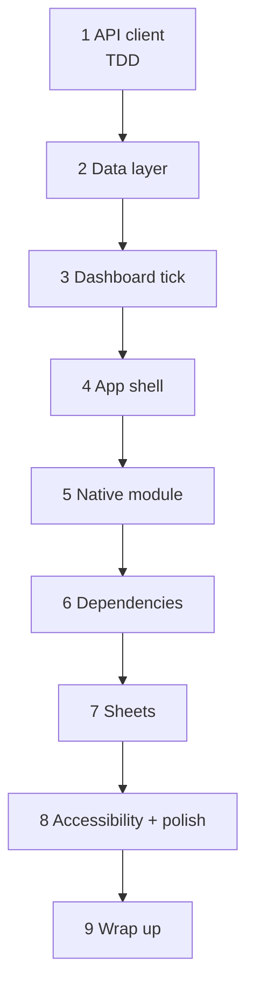

# Expo review: the picture

## The idea in one line

A review against the official Expo skills found **six real bugs** and a JS thread doing more work than it needs to. This plan fixes them and tidies up along the way. **Nothing Molly shows or predicts changes.**

## The four groups

Bugs come first. JS-thread load matters next, because a busy JS thread is one suspect for taps that die (`implan-instant-taps`).

## The six bugs

| # | What a parent would see | Why |
| --- | --- | --- |
| 1 | Tap Stop, it flips back to running for a moment, then to stopped | A 30 s poll lands mid-write and puts the old state back |
| 2 | Back on Settings does nothing the first time | The dashboard's Back handler keeps listening while it's in the background |
| 3 | The app hangs on the splash forever | A storage read fails and nobody catches it |
| 4 | Lock-screen card stuck on "Stopping…" with no buttons | A start-up race in `ActionWorker`: the JS task never runs |
| 5 | After an edit the ring is right but "Nap likely" is stale | Sleeps are fetched twice, and only one copy gets the edit |
| 6 | "No permission" toast on a proxy hiccup | Any odd 4xx is treated as a refused key |

## Bug 1: the write and the poll

**After:** while a write is in progress, polls and focus refetches pause. The same "write in progress" count also tells the persisted cache which queries are only guesses.

## JS-thread load: before and after

| | Today | After |
| --- | --- | --- |
| Dashboard re-render | every **second** (whole ring, day plan) | every **minute**; only the centre timer and running tile tick each second, on one shared clock |
| Notification sync | 4+ blocking native calls | async, off the JS thread |
| Native packages loaded at every widget/notification start | 5 nobody uses | removed |
| Requests per tap | ~12 (10 keys invalidated) | only what's on screen |
| A cancelled request | keeps running up to 15 s | aborted |
| Retry on a 4xx | yes | never; only on `unreachable` / `server` |

## Hygiene, in short

- **Versions** lined up with SDK 57 (`npx expo install --fix`). The patched widget library is pinned to exactly `0.22.1`.
- **Router:** a `+not-found` page that redirects home. Reloading `/settings` on the web keeps the dashboard underneath. An error screen with **Try again** instead of a blank screen.
- **Cache:** the last good data survives being killed mid-refresh, guesses are never saved, and paging never repeats an entry.
- **Small safety fixes:** a bad colour can't crash the notification tap, and the skeleton uses the form that's safe with the React Compiler.

## Sheets after

- **Remove animations** on → no slide, it just appears.
- **Keyboard:** the sheet moves *with* the keyboard (`react-native-keyboard-controller`), not after it.
- **TalkBack** can't reach buttons behind an open sheet.

## Accessibility and polish

- Every tappable shows it's pressed. Press scale tops out at **0.97**. The ripple stays in `implan-instant-taps`.
- Timers speak minutes, not seconds, so TalkBack doesn't re-read them every tick.
- The Add button says *why* it's dimmed.
- Segment options reach **48 dp**.
- Repeated pixel font sizes and radii become named tokens. Every theme looks the same afterwards.

## The steps

Each step lands and commits on its own. `pnpm check` must be green after every one.

## Where the lines are

- **Here:** the bugs, the JS-thread load, hygiene, sheets, and press feedback for tappables that have none.
- **`implan-instant-taps`:** the native ripple, the widget's pressed overlay, and the app freeze itself.
- **Left out on purpose:** the AsyncStorage → SQLite move, the cleartext setting, Help as a modal, sheets as routes. The reasons are in `NOTES.md`.
