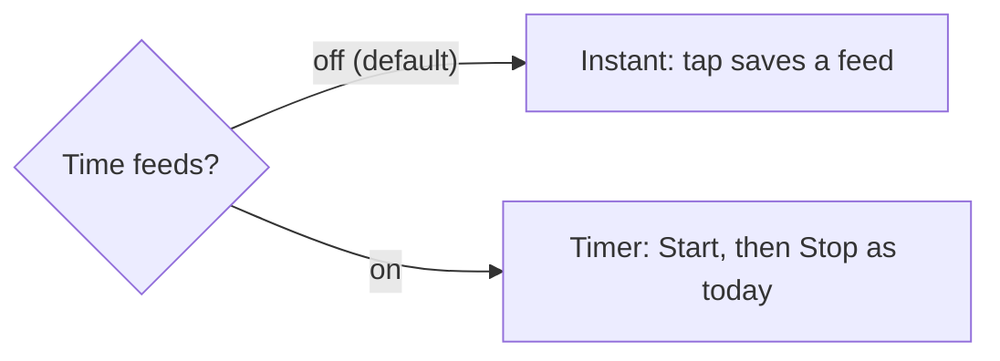
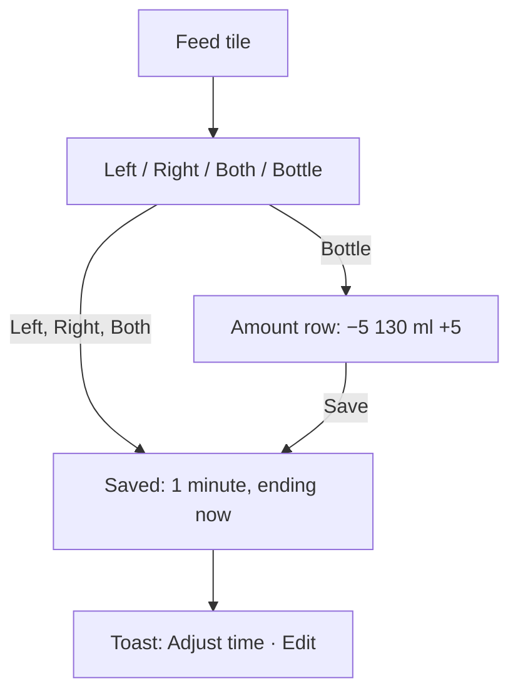
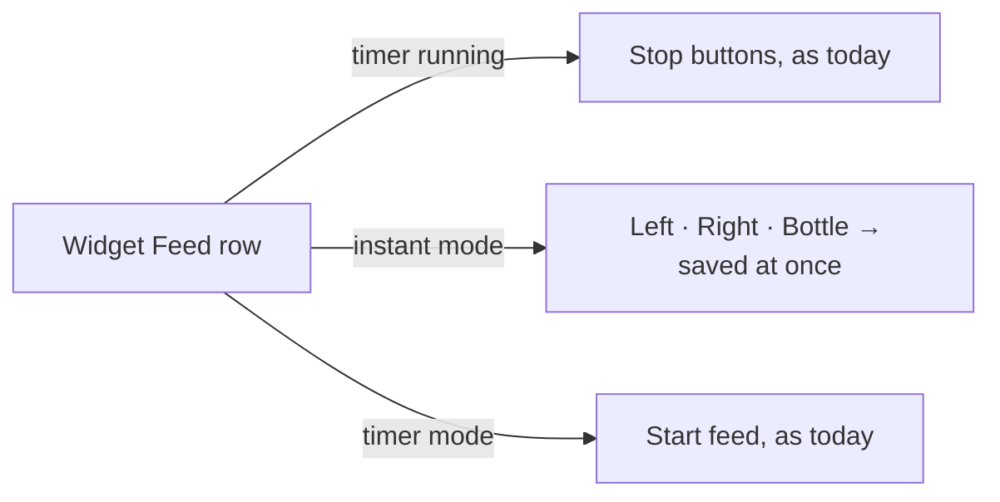

# Instant feeds: the mental model

## In one line

A feed is something you **log**, not something you **time**: one tap saves it, and a bottle asks for its amount first.

## The switch

One setting per phone (and browser): **Time feeds**. Off by default.

Each parent picks for their own phone. Nothing is shared, so one parent can time feeds while the other logs them.

## The instant flow in the app

- The **amount starts at the last bottle** (its type too), or the child's bottle setting if there's no earlier one.
- **Tap the number** to type an amount instead of stepping.
- **Adjust time** slides the whole feed, so "fed 10 minutes ago" is one tap.

## Why one minute, not zero

A saved feed still has a start and an end, so everything that reads feeds keeps working: the ring shows it as a mark, and the totals, ml line and needs count it as before.

The start never goes before the previous feed's end. Baby Buddy refuses feeds that overlap.

## The amount row is everywhere a bottle is picked

| Where | Mode | What Bottle does |
| --- | --- | --- |
| Feed tile picker | instant | amount row, then save |
| Stop picker of a running timer | timer (or another phone's timer) | amount row, then stop |
| Add entry | both | amount row in the form |
| Widget | instant | saves the **last bottle** at once |
| Widget / lock screen, running timer | timer | stops with the **last bottle** |

The widget and the lock screen trade the amount step for speed. Edit in the app fixes a wrong amount.

## The widget

A running timer always wins, whatever the setting: it was started on purpose, maybe on the other phone.

## What doesn't change

Sleep, diapers, medicine, predictions, the ring, Recent days. They read feeds the same way whether a feed was timed or logged.

## The order of work

1. Ask Baby Buddy what it accepts (one-minute feed, back-to-back feeds, finding the last bottle).
2. Pure rules: the times, the last bottle, stepping and typing the amount.
3. Saving, Adjust time, instant on-screen update.
4. The setting.
5. App screens.
6. Widget and lock screen.
7. Look review and wording.
