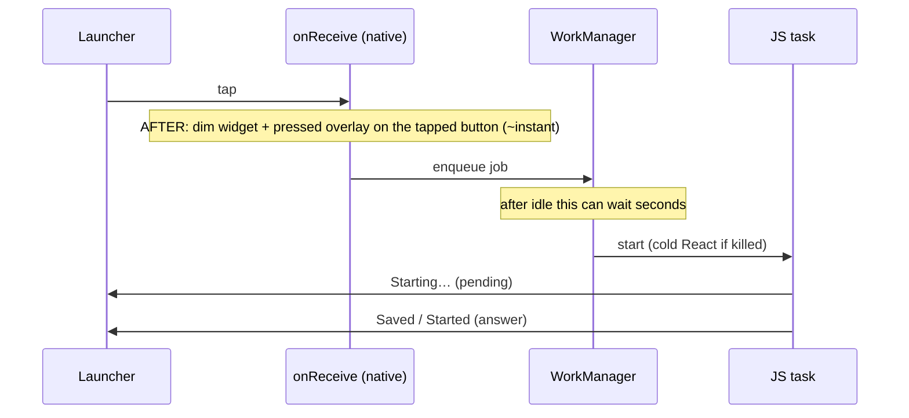
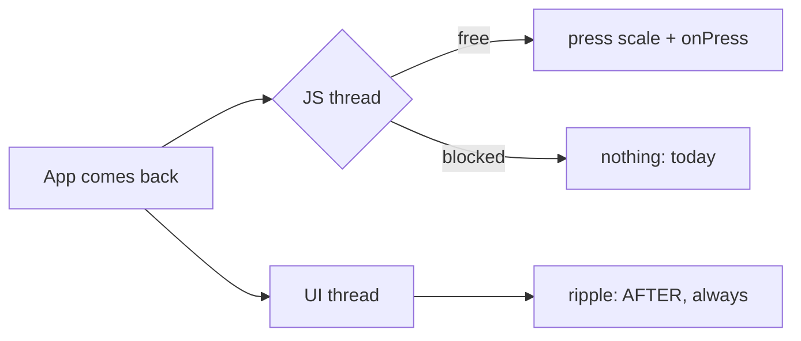

# Instant taps: the picture

## The idea in one line

A tap must show it landed **without waiting for JS**. JS still draws `Starting…` and the answer, as today. This adds a native layer underneath, and fixes the things that make taps die.

## Two symptoms, two causes

| Where | What the user sees | Cause |
| --- | --- | --- |
| Widget, phone idle a while | Nothing for seconds, then it runs | Feedback waits for JS, and after idle JS starts late (Doze, dead process, deferred work) |
| Widget, any time | Some buttons never fire | Library bug: buttons drawn in the same millisecond cancel each other's tap |
| App, after coming back | Stop doesn't react at all, scrolling works, only a restart helps | JS thread blocked or spinning (cause found in step 1) |

## Widget tap: today vs after

Today the first visible change is `Starting…`. After this work, the first change is the overlay, drawn by `onReceive` before WorkManager or JS.

## The pressed overlay

- The library draws the widget as **one picture** with invisible tap areas on top.
- On tap, native code dims the picture and lays a translucent rounded rect over the tapped button. It knows where the button is because the patch puts its bounds into the tap.
- It's a *partial* update: the tap areas stay, so the widget keeps working.
- JS's next draw replaces it. So **JS must redraw after every tap**, including a tap it drops ("another tap still pending").

Fallback if the overlay won't line up: dim only.

## Dead buttons

Each button's tap is a `PendingIntent` keyed by a request code. The library uses the current millisecond, so two buttons drawn in the same millisecond share a code, and the second cancels the first. Fix: a counter. One line in the same patch.

## Faster, only if it pays

If the measurements show WorkManager itself holds the tap for more than ~1 s after idle, clicks skip the deferral (a foreground start, which Android allows after a widget tap). Otherwise: written down and skipped.

## App: freeze, then ripple

1. **Find the freeze** on the emulator (idle, clock forward, return) with a stall logger and a profile. Fix it where it lives.
2. **Native ripple** on every button through the shared `Pressable`. It runs on the UI thread, so a press shows even if JS is late.

If the freeze won't reproduce on the emulator, a hidden Tap log ships so it can be caught on a physical phone.

## Order

1. Measure and reproduce
2. Fix the freeze
3. Ripple
4. Widget patch (codes, bounds, overlay, always redraw)
5. Faster widget taps, if the numbers say so
6. Wrap up
