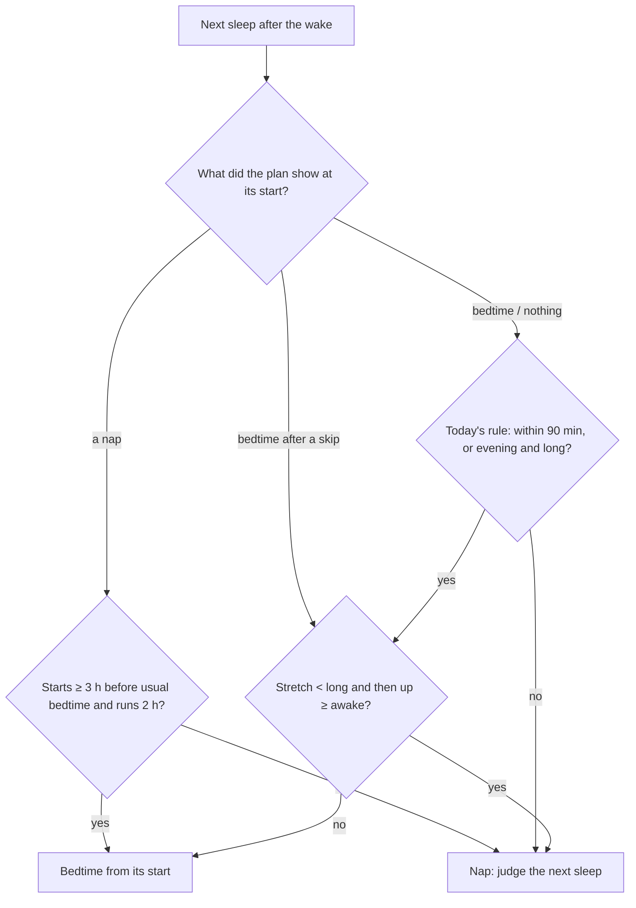

# Mental model: a planned nap near bedtime stays a nap

## The problem in one line

The plan calls a sleep from 20:30 a nap; the day/night rule calls anything from 20:15 the night, and nothing ever takes it back.

## Before and after

Learned bedtime 21:45, 3–6 month band (`awake` 60, `long` 2 h). The plan showed nap 3 at 20:30.

```
            20:30 nap 3   21:05 up            23:20 real bedtime
              │█████████│                       │████████████████…
before  ──Today──┤ Tonight from 20:30 ─────────────────────────────▶
after   ──Today (from 07:00) ───────────────────┤ Tonight from 23:20 ▶
```

No plan (or the plan said bedtime), same sleeps: the night from 20:30 until the baby has been up 60 min, then undone.

```
            20:30         21:05        22:05                23:20
              │█████████│                │                    │█████…
after   ──Today──┤ Tonight (too soon) ─┤ Today ───────────────┤ Tonight from 23:20 ▶
```

## The decision, per sleep after the morning wake



## The seam

```
day-rhythm.ts   DayRhythm { …, shown: ShownAt | null }   (type only, dayRhythm sets null)
      ▲
day-window.ts   dayOn → rhythm.shown?.(before, start)    (no planner import)
      ▲
next-sleep.ts   today: rhythm as given · pastDays: withoutPlan(rhythm)
      ▲
day-plan.ts
      ▲
shown-plan.ts   withPlan(rhythm, birthDate, skips) = { …rhythm, shown: (before, at) => first unskipped of
                dayPlan(before, null, birthDate, withoutPlan(rhythm), skips, at) }
      ▲
app             withPlan(dayRhythm(…), birthDate, skips) wherever the rhythm is built
```

Depth is two at most: the app's call judges a day; each judgement runs one plain plan, which never asks again.
