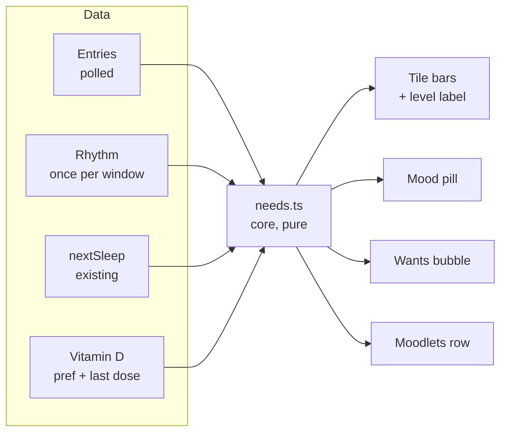
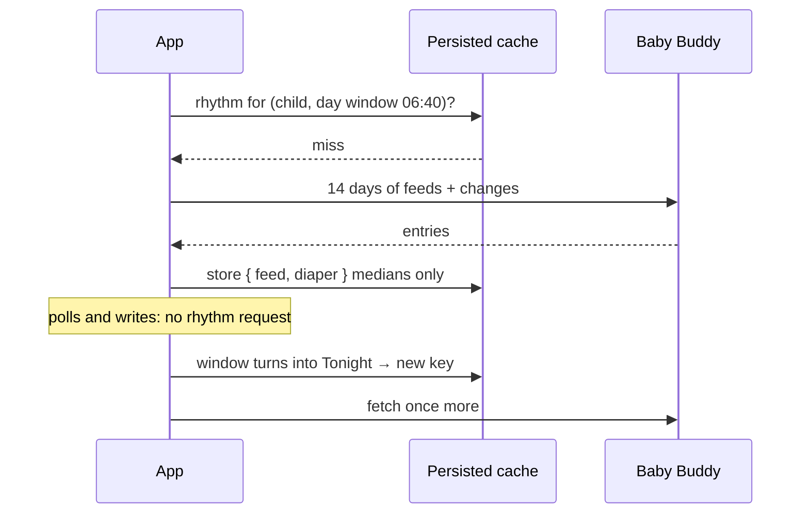
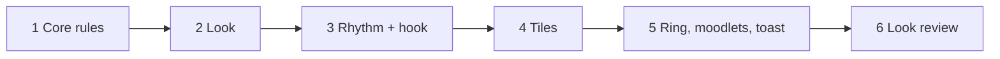

# Life Sim: mental model

The baby as a life-sim character. Same Ring v4 app, new skin, plus a **needs layer** that turns "how long since" into bars, a mood and wishes. Details in [`MAIN.md`](MAIN.md); decisions in [`NOTES.md`](NOTES.md).

## The picture



Core computes numbers. The theme turns them into colours and words. Screens draw only when the theme has a `needs` slot.

## One need, one number

Every need is a value **0–100**: full right after an entry, empty when the next one is "due".

```
value = 100 × (1 − time since last ÷ usual gap)        clamped to 0–100
```

Four levels with the theme's words, e.g. feed:

| Value | > 75 | > 50 | > 25 | else |
|---|---|---|---|---|
| Label | Milk drunk | Snacky | Rooting around | HANGRY |

Colour slides red → green with the value. A running timer shows `Recharging…` instead.

## What "usual gap" means per tracker

| Tracker | Due when | Source |
|---|---|---|
| Sleep | next likely nap starts | `nextSleep` (ring ghost time) |
| Feed | median gap, same window kind | rhythm, 14 days |
| Diaper | median gap, same window kind | rhythm, 14 days |
| Medicine | 24 h after last Vitamin D | only if Vitamin D reminder on, else **no bar** |

Too little history → the design's fixed times (feed 3 h, diaper 3.5 h, sleep 2.5 h).

## The rhythm is slow on purpose

The usual gaps barely change, so they are not polled.



Day gaps feed the day median, night gaps the night one: night feeds are further apart.

## Mood, Wants, moodlets

- **Mood** = average of sleep, feed, diaper. Giggly → Content → Fussy → Wailing. `Dreaming` while asleep.
- **Wants** = the lowest of those under 60, else a toy.
- **Moodlets**: `+` for anything logged in the last 30 min, `−` for a need under 25.

**Medicine never counts** toward mood, Wants or bad moodlets. A baby on no medicine shouldn't look upset.

## Where it shows

```
┌───────────── ring ─────────────┐
│        [☀ 😊]  ← mood pill     │   cap stays tappable
│                                │
│          Up and about          │
│            2h 10m              │
│          [ Content ]           │   mood chip
│ (🍼)                           │   Wants bubble
│ wants                          │
└────────────────────────────────┘
 [Fresh bum +1] [Hangry −3]          moodlets
 Nap 2 likely 12:40–13:10 in 30m     window row (unchanged)
 ┌ Sleep ── 2h ┐ ┌ Feed ── 10m ┐
 │ Yawning     │ │ Milk drunk  │     level label
 │ ▮▮▮▮▮▮▯▯▯▯ │ │ ▮▮▮▮▮▮▮▮▮▯ │     need bar
 └─────────────┘ └─────────────┘
```

## Switches that change it

- **Other theme picked** → no needs layer at all, nothing computed.
- **Playful labels off** → bars, colours, faces stay; words (levels, mood names, moodlets) go.
- **Widgets / lock screen** → Life Sim colours, fonts, words only.
- **TalkBack** → reads the plain tile text. The needs layer is decoration.

## Order of work


