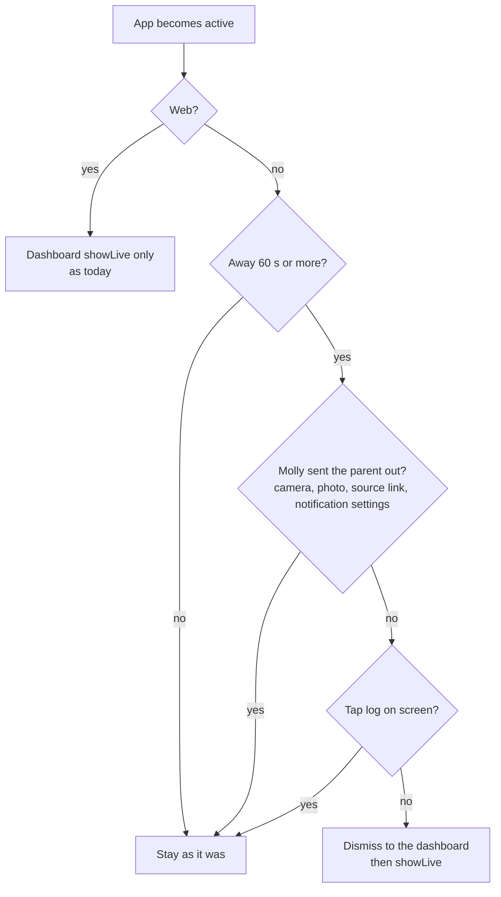
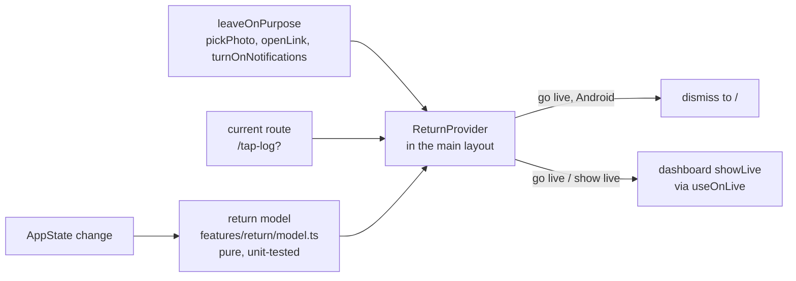

# Mental model: back to now when the app comes back

## The problem in one line

Only the dashboard snaps back to now on return. Left on Settings or To-do, Molly reopens there, and the parent has to find the way back to the ring.

## Before and after (Android)

A parent checks Recent days, locks the phone, and picks it up 20 minutes later.

```
           leaves on        comes back 20 min later
before     Recent days  ──▶  Recent days        (back → dashboard, maybe a past ring)
after      Recent days  ──▶  dashboard, live ring (back → leaves the app)
```

## The decision on each return



"Stay" means nothing at all changes, on the dashboard too: a past ring, the editor, the open panel all stay.

## Unsaved input is dropped

After a minute away, a half-written to-do or an unsaved setting goes with its screen.

| Where | What the parent sees |
| --- | --- |
| Settings, child screen with changes | "Changes not saved" toast over the live ring (already there today when leaving with changes) |
| To-do, measurement or Add entry sheet, dashboard editor | closed, no message (as when closed any other way) |

## A trip is one return

```
tap Camera   ──▶ mark "on purpose" ──▶ camera (3 min) ──▶ back: mark used, stay
lock phone 5 min later ──────────────────────────────────▶ back: no mark, go live
```

## Where it lives



The provider sits in the signed-in layout, so onboarding and "Can't sign in" never see it.

## What goes away

The dashboard's own "every return → now" listener. On Android the dashboard now waits for the same minute as every other screen; on the web the shared listener still snaps it back on every return. Its in-app glance timer (a past ring goes back to now after a minute on screen) stays.

## Web

Unchanged: showing the tab again puts the dashboard on the live ring, and screens above it stay where they were.
