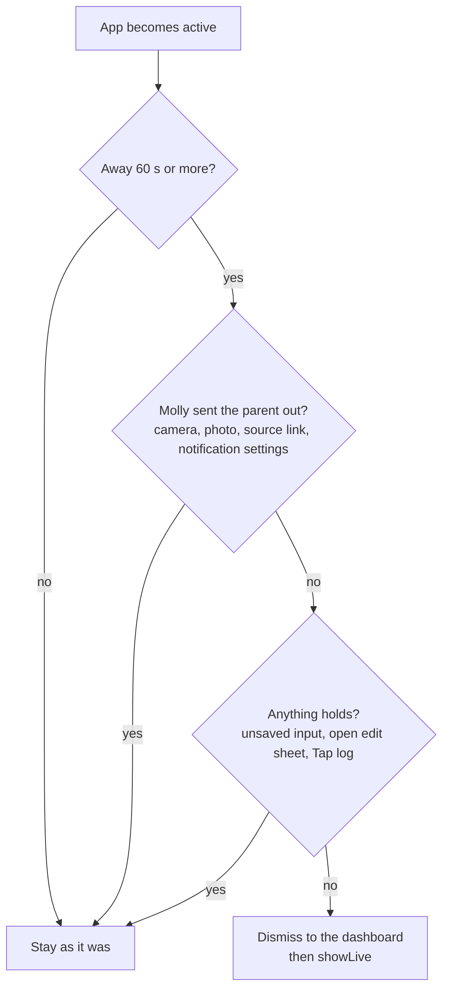
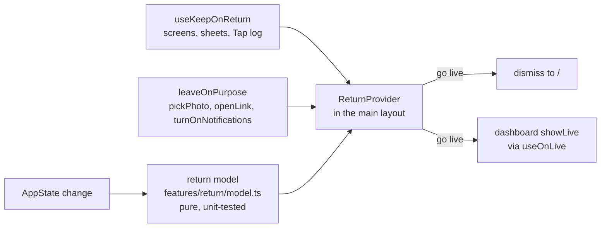

# Mental model: back to now when the app comes back

## The problem in one line

Only the dashboard snaps back to now on return. Left on Settings or To-do, Molly reopens there, and the parent has to find the way back to the ring.

## Before and after

A parent checks Recent days, locks the phone, and picks it up 20 minutes later.

```
           leaves on        comes back 20 min later
before     Recent days  ──▶  Recent days        (back → dashboard, maybe a past ring)
after      Recent days  ──▶  dashboard, live ring (back → leaves the app)
```

## The decision on each return



"Stay" means nothing at all changes, on the dashboard too: a past ring, the editor, the open panel all stay.

## What holds

| Screen | Holds while |
| --- | --- |
| Settings, child screen | there are unsaved changes |
| To-do | the edit sheet is open (new or edit) |
| Child screen, measurement screen | the measurement sheet is open |
| Dashboard | the Add entry sheet is open, or the editor has changes |
| Tap log | always |

A hold anywhere in the stack keeps the whole stack. Settings with changes under a child screen still counts.

## A trip is one return

```
tap Camera   ──▶ mark "on purpose" ──▶ camera (3 min) ──▶ back: mark used, stay
lock phone 5 min later ──────────────────────────────────▶ back: no mark, go live
```

(The to-do sheet would hold anyway while it's open; the trip matters for the source links and Android's settings.)

## Where it lives



The provider sits in the signed-in layout, so onboarding and "Can't sign in" never see it.

## What goes away

The dashboard's own "every return → now" listener. The dashboard now waits for the same minute as every other screen. Its in-app glance timer (a past ring goes back to now after a minute on screen) stays.

## Web

The same rule runs in the browser: a hidden tab is "away". That's also how Playwright tests it.
