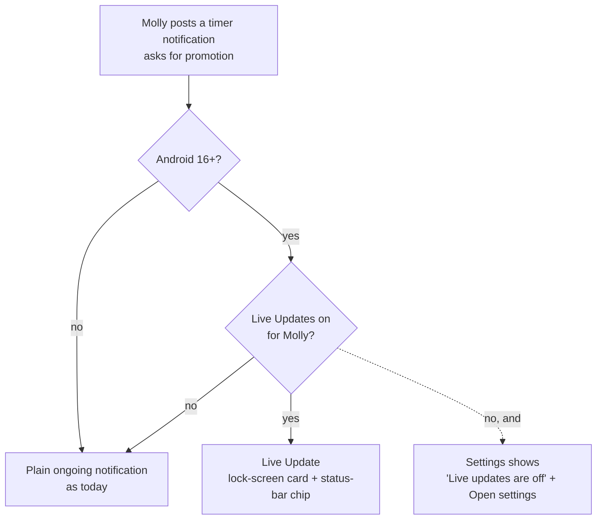
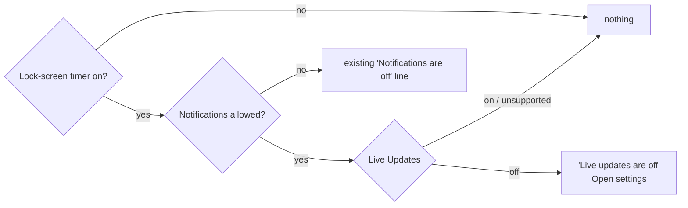

# Live Updates: the picture

Same notification as today, **asking Android to promote it**. On Android 16+ with Live Updates on, it becomes a lock-screen card and a status-bar chip with the ticking timer. Everywhere else it stays a plain ongoing notification.

## Plain or promoted

Molly always asks. Android decides. Nothing else about the notification changes.

## What promotion needs, and what Molly already has

| Rule | Molly today | Change |
| --- | --- | --- |
| `POST_PROMOTED_NOTIFICATIONS` permission | missing | add to manifest |
| Request promotion | missing | `setRequestPromotedOngoing(true)` |
| Ongoing + title | yes | – |
| No style / allowed style, no custom layout | no style | – |
| Not colorized, not a group summary | yes | – |
| Chip text | chronometer from timer start | – (the chip ticks by itself) |

Two lines of native code and one permission do the promotion.

## Every state stays promoted

Running, a tap being sent (`Stopping…`), an error line, "Can't sign in": all ask for promotion. The card never drops back to plain in the middle of a timer.

## The Settings hint

Checked again whenever Molly comes back to the front, like the permission. Web never shows it.

## Not in this

No progress bar (no target to fill towards), no `37m` text chip, no widget changes.
