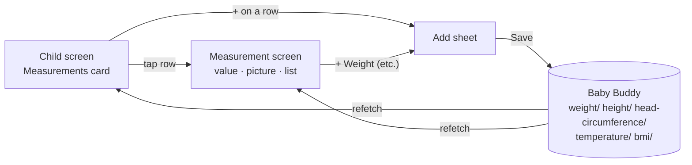
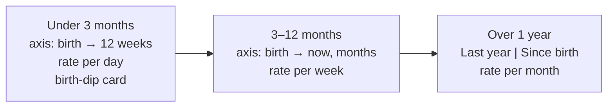

# Measurements: the picture

Full detail in [`MAIN.md`](MAIN.md). This page is the short version.

## In one sentence

The child screen gets a Measurements card with five rows. Each opens its own screen with its own picture, and one add sheet logs any of them to Baby Buddy.

## Where you go



Nothing else in Molly changes: no ring marks, no widget, no notification, nothing in the Add entry sheet.

## The card

```
┌──────────────────────────────────────────┐
│ Measurements                             │
│ Weight              23 Sep   7 050 g [+] │
│ Height              23 Sep   65.5 cm [+] │
│ Head circumference  23 Sep   42.3 cm [+] │
│ Temperature    Today 07:40   36.9 °C [+] │
│ BMI                 23 Sep      16.3 [+] │
└──────────────────────────────────────────┘
```

The row opens the screen, the `+` opens the sheet: two separate targets. No entries yet → `None yet`, still with `+`.

## One picture per measurement

| Measurement | Picture | Line under the big value |
| --- | --- | --- |
| Weight | Line over WHO bands (3–97, 15–85, dashed 50th) | `+470 g in 16 days · about 29 g a day` |
| Height | Doorframe: ruler plus a mark per entry | `15.5 cm taller than at birth` |
| Head | Concentric rings, birth in the centre | `+0.7 cm since August` |
| Temperature | Zone bar with pins, plus a fever card | `Today 07:40 · Normal` |
| BMI | `weight ÷ height²` card and bars | date |

Every screen ends with a list of the latest entries and the change from the one before.

## Weight changes with age



The WHO bands need the child's sex. Sex is set on the child screen and kept on this phone only. If it isn't set, the chart shows the line without bands or the centile chip.

The centile chip compares where the child is now with birth or the past year. Example: `Just above the 50th centile, as at birth`.

## Height labels change too

Under 1 year the doorframe shows every mark since birth, dated (`Birth`, `21 May`). Over 1 year it shows the last year's marks, labelled by age (`1 year`, `15 months`).

## Temperature zones and episodes

```
 35.5   36        37.5  38                 40
  │ Low │  Normal  │Raised│      Fever       │
```

A fever episode starts at the first reading of 38.0 or more. It ends at the first Normal reading after that. The card shows the latest episode from the last 30 days: dates, peak, how long until normal, and the number of readings.

## The add sheet

```
┌──────────────────────────────────────────┐
│ Weight entry          Last 7 000 g · 23 Sep
│   [−]        7 050 g        [+]          │  steps: 10 g · 0.5 cm · 0.1 °C · 0.1
│        +50 g · tap to type               │
│ [Today] [Yesterday] [Pick date]          │  temperature also has a time
│ Notes                                    │
│ [        Save weight        ]            │
└──────────────────────────────────────────┘
```

The stepper starts at the last value. For BMI it starts at today's weight ÷ height² when both are logged today.

## What's stored where

| Thing | Where | Shared between parents? |
| --- | --- | --- |
| Every measurement | Baby Buddy (weight in **grams**) | Yes |
| Sex | `settings.children[id].sex` on the phone | No, each phone sets it |
| WHO weight tables | Committed data in `packages/core` | – |

## Where the code lives

- **`packages/api`**: list and log calls for the five endpoints.
- **`packages/core`**: every rule. Bands, chip, rate words, birth dip, axis, height labels, fever episodes, BMI, the sheet's steps and starting values.
- **App**: lays out what core returns. New colour tokens for every theme, playful labels in `copy.ts`.

## Not in this plan

- Editing or deleting a measurement (fix it in Baby Buddy).
- Centiles for height, head or BMI.
- Corrected age for premature babies.
- Imperial units.
