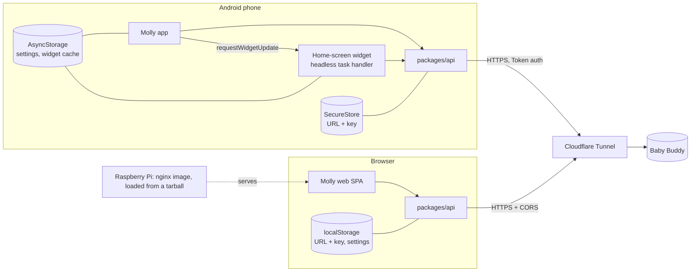
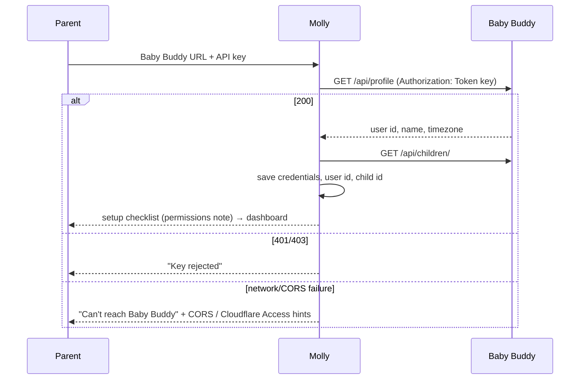

# Molly: plan

Molly is a fast, one-handed front end for logging a baby's **sleep, feedings and diaper changes**. It runs as a web app (static files in an nginx Docker image on a Raspberry Pi), an Android app (a locally built APK) and an Android home-screen widget.

Molly has **no backend and no database**. All data lives in the family's self-hosted [Baby Buddy](https://github.com/babybuddy/babybuddy) instance, which each client calls directly over its REST API. Baby Buddy is installed and run separately; Molly never manages it.

Both parents run Molly on their own devices, each with their own Baby Buddy user and API key. A timer started on one phone must be stoppable from the other.

`NOTES.md` has the verified API facts and the reasoning behind each decision. The roadmap is at the end of this file. The detailed MVP plan is in [`phases/mvp/MAIN.md`](phases/mvp/MAIN.md); the redesign that follows it is in [`phases/redesign/MAIN.md`](phases/redesign/MAIN.md).

## Goals and non-goals

**Goals:** the fewest possible taps to log something. Correct shared state between two parents. Clear errors when Baby Buddy can't be reached.

**Non-goals for now:** offline support or write queueing, iOS, languages other than English, a Molly backend or proxy, managing Baby Buddy.

## Stack

| Concern | Choice |
| --- | --- |
| Repo | pnpm workspace monorepo, TypeScript everywhere |
| App | Expo (React Native) + Expo Router. One codebase for Android and web |
| Styling | NativeWind |
| API state | TanStack Query (app only) |
| Widget | `react-native-android-widget` (JSX widgets and a headless task handler) |
| Credentials | `expo-secure-store` on Android, `localStorage` on web |
| Device settings | AsyncStorage (works on web, in the app, and in the headless widget handler) |
| Tests | TDD by kind of work: Vitest unit tests (`core`), Vitest integration tests against a Baby Buddy test container (`api`), Playwright on the web image, and a manual Android device checklist. See `TEST_STRATEGY.md` |
| Web serving | Expo web export (`web.output: "single"`, an SPA) → nginx image, multi-arch |

### Stack check: where it will fight you

1. **Web and widget in one app.** It works if widget code never reaches the web bundle:
   - Put all `react-native-android-widget` imports in `*.android.ts(x)` files.
   - Use a custom entry file: `index.ts` registers the widget task handler (Android only) and then imports `expo-router/entry`. Point `package.json` `main` at it.
   - The widget library needs native code, so use `expo prebuild` or a dev client. Expo Go won't work, which the local APK build needs anyway.
2. **The widget handler runs headless JS** with no React tree, no router and no query client. Everything it needs (API calls, credential reads, settings, domain rules) must live in plain TypeScript packages that don't import React. This is the main reason for `packages/api` and `packages/core`.
3. **`expo-secure-store` has no web implementation.** Hide storage behind a small interface with `.native.ts` and `.web.ts` implementations.
4. **Version coupling.** NativeWind's version depends on the Tailwind version, which the Expo SDK pins. Pick the latest stable Expo SDK and the NativeWind release that matches it. Check that pnpm installs work, and use `node-linker=hoisted` in `.npmrc` if Metro struggles. Check that `react-native-android-widget` supports that SDK. This is the first MVP task (see the MVP plan).
5. **No push from Baby Buddy.** Nothing tells a device that the other parent logged something. The design below is built around this; don't try to solve it with a backend.

## Architecture



### Components

- **`packages/api`**: typed Baby Buddy client. A `fetch` wrapper takes `{ baseUrl, token }`. It exposes endpoint functions and turns failures into a small error set: `unreachable`, `unauthorized`, `forbidden`, `notFound`, `validation`, `server`. No React. The app wraps it in TanStack Query hooks; the widget handler calls it directly.
- **`packages/core`**: pure domain logic with no I/O. It covers the nap rule, which feeding method means which type, the default bottle amount, "last X" and today's totals (including clipping sleep that crosses midnight), the timeline merge, and later the prediction engine. This is where most unit tests live.
- **`apps/molly`**: the Expo app. Screens are onboarding, dashboard, tracker actions, edit entry and settings. It also holds platform storage adapters, the Android widgets (`src/widget/*.android.tsx`) and, from the redesign phase, a lock-screen notification for running timers that shares the widget's headless action path.

### Timers are the shared state

Sleep and feeding run on Baby Buddy **timers**, so both parents see the same running timer.
- Molly names its timers `molly:sleep` and `molly:feeding` and finds them with `GET /api/timers/?child=<id>&name=<name>`.
- Stopping means POSTing the entry with `"timer": <id>`. Baby Buddy fills in start and end and deletes the timer.
- Timers without a `molly:` name belong to someone else, for example the Baby Buddy UI, and Molly ignores them.

**Every action states its intent and checks the server first.** The widget and the app send `start` or `stop`, never `toggle`. Before acting, they fetch the current timer:
- **Start when a timer already exists:** create nothing. Refresh and show "already running since HH:MM".
- **Stop when no timer exists:** refresh and show "already stopped".
- **Timer gone on stop** (400 `Invalid pk` on the entry POST, or 404): the other parent got there first. Treat it the same as "already stopped".
- **403 on stop:** this user can't consume someone else's timer. Show "Started by someone else; your Baby Buddy user needs permission to stop other people's timers", with a link to the setup docs. The API has no users endpoint, so Molly can only say "you" or "someone else", never a name.

Diaper changes have no timer. If both parents log the same change, you get a duplicate. Showing "last change at HH:MM" makes that visible, and the timeline allows delete.

### Keeping devices in sync

- **App:** queries refetch on focus and on app foreground. While the dashboard is visible, active-timer and last-entry queries poll every 30 s.
- **Widget:** the app calls `requestWidgetUpdate` after every successful write and on every foreground. The widget also refreshes on its own taps and on Android's periodic update (`updatePeriodMillis`, minimum 30 min).
- The widget caches its last snapshot in AsyncStorage. It renders from the cache at once, fetches, then re-renders. If the fetch fails, it shows the cached data marked "not updated since HH:MM".

Result: the widget can be up to 30 min stale about the *other* parent's actions. Because every action checks the server first, stale state can never cause a wrong write.

### Onboarding and credentials



- Normalise the URL: strip trailing slashes and any `/api` suffix, and require `https://`, except `http://` for LAN or localhost addresses.
- With one child, select it automatically. With several, pick one on a step in onboarding and change it in settings. Every query and write takes a child id; don't hard-code one child anywhere below the UI.
- **Android:** URL, key and user id go in SecureStore. The widget handler reads them there.
- **Web:** URL, key and user id go in `localStorage`. The risk is that any XSS on Molly's origin can read the key, and the key gives full access to that parent's Baby Buddy data. Mitigations:
  - Molly's origin sits behind Cloudflare Access.
  - nginx sends a strict CSP whose `connect-src` allows only the configured Baby Buddy origin.
  - No third-party scripts or CDNs at runtime.
  - Sign out clears storage.

  This is accepted for a two-person private deployment.
- Per-device settings (bottle default type and amount, nap window, selected child) live in AsyncStorage. Nothing is shared between parents.

### Deployment

- **Baby Buddy** is exposed through Cloudflare Tunnel. Its environment needs `CORS_ALLOWED_ORIGINS=https://<molly-web-origin>`. If Cloudflare Access protects Baby Buddy's hostname, `/api/*` needs a bypass rule, because Molly authenticates with a token, not an Access login.
- **Molly web:** build `expo export -p web` on the Mac and copy `dist/` into an `nginx:alpine` image, with SPA fallback (`try_files … /index.html`), cache headers for hashed assets, and the CSP. No registry: `pnpm web:up` runs it on the Mac, and `pnpm web:image:pi` writes an arm64 image tarball that the Pi loads with `docker load` and runs with `docker/compose.yml`. The image contains no secrets: Baby Buddy's URL is entered at runtime, and the CSP's allowed origin comes from `BABY_BUDDY_ORIGIN`, templated into the nginx config at start.
- **Android APK:** `expo prebuild -p android`, then `./gradlew assembleRelease`, run locally on the Mac with a local JDK and Android SDK. The release keystore stays at a path outside the repo, with its passwords in `~/.gradle/gradle.properties`. Back up the keystore and passwords to a password manager: if the keystore is lost, installed apps can't be updated. Install with `adb install -r` or by sideloading. Nothing uses the Play Store or EAS cloud.

## Feature → Baby Buddy API

Verified against Baby Buddy v2.11.0 source. Check against the live instance's `/api/` browsable API (and `OPTIONS` on each endpoint) before relying on it; see `NOTES.md`.

| Molly feature | Call | Fields / notes |
| --- | --- | --- |
| Validate credentials | `GET /api/profile` | `user.id` (kept as "me"), `user.first_name`, `timezone` |
| List children | `GET /api/children/` | `id, first_name, last_name, birth_date, slug`. Detail route uses `slug` |
| Running timers | `GET /api/timers/?child=&name=molly:sleep` (and `molly:feeding`) | `id, start, user, duration` |
| Start sleep / feeding | `POST /api/timers/` | `{ child, name }`. `start` defaults to server time |
| Cancel a timer | `DELETE /api/timers/{id}/` | "Started by mistake" |
| Adjust a timer's start | `PATCH /api/timers/{id}/` | `{ start }`, for "Adjust time" after a late start (redesign phase). Permission for plain caregivers to be confirmed |
| Stop sleep | `POST /api/sleep/` | `{ timer, nap }`. `nap` from the nap rule applied to the timer's start |
| Stop feeding | `POST /api/feedings/` | `{ timer, type, method, amount? }`. Widget: Left/Right → `breast milk` + `left breast`/`right breast`. Bottle → `method: bottle`, type and amount from device defaults |
| Log diaper | `POST /api/changes/` | `{ child, time, wet, solid }`. Wet / Dirty / Both → `{t,f}` / `{f,t}` / `{t,t}` |
| Manual entry | `POST /api/sleep/`, `/api/feedings/` with `start`/`end`, `/api/changes/` with `time` | `child` required when no `timer` is given |
| Edit / delete entry | `PATCH` / `DELETE /api/{sleep,feedings,changes}/{id}/` | Amount, method, color, nap, times, `notes`, `tags` (e.g. a "mixed" bottle) |
| Last of each | `GET /api/{sleep,feedings,changes}/?child=&limit=1` | Check the default ordering is newest first. Otherwise pass `ordering` |
| Today's totals | `GET /api/sleep/?child=&end_min=<local midnight>`, `/api/feedings/?child=&start_min=…`, `/api/changes/?child=&date_min=…` | Clip sleep that crosses midnight. Follow `next` pagination |
| Timeline | Same three lists with a time window, merged client-side | Paginate with `limit`/`offset` |

Enums: feeding `type`: `breast milk | formula | fortified breast milk | solid food`. `method`: `bottle | left breast | right breast | both breasts | parent fed | self fed`. Change `color`: blank or `black | brown | gray | green | orange | red | white | yellow`. Always send timestamps as ISO 8601 with an offset, and show them in the device timezone.

## Repository layout

```
molly-app/
├── apps/molly/                 Expo app (Android + web)
│   ├── index.ts                entry: registers widget handler (android) → expo-router/entry
│   ├── app/                    Expo Router routes: (onboarding)/, (main)/, settings
│   ├── src/features/           dashboard, sleep, feeding, diaper, entries, settings
│   ├── src/storage/            credentials.native.ts / credentials.web.ts, settings
│   ├── src/widget/             *.android.tsx: widget UI + task handler
│   └── app.json                includes react-native-android-widget config plugin
├── packages/api/               Baby Buddy client + types, no React
├── packages/core/              pure domain logic, no I/O
├── e2e/                        Playwright tests + docker-compose (Baby Buddy + Molly web)
├── docker/                     Dockerfile, nginx.conf.template, compose.yml
├── docs/                       setup.md (Baby Buddy config, Cloudflare), android-build.md
├── pnpm-workspace.yaml
└── plans/implan-molly/         this plan
```

The Baby Buddy test container is `lscr.io/linuxserver/babybuddy` (default login `admin`/`admin`). Seed it with a child and a second non-superuser, and read API keys from `/api/profile`, using `manage.py` inside the container or a setup script.

## Roadmap

Each phase ships something usable. Phases after the MVP are outlines. Plan each one in detail when you reach it, in its own `phases/<name>/` folder.

1. **MVP**: see [`phases/mvp/MAIN.md`](phases/mvp/MAIN.md). Onboarding, the three trackers, dashboard, entry edit and delete, the combined widget, web Docker image, APK build, setup docs.
2. **Redesign**: see [`phases/redesign/MAIN.md`](phases/redesign/MAIN.md). Implements the (private) design source "Molly Redesign": day/night visual system, new dashboard and edit screen, optimistic updates, toast with "Adjust time" (quick late logging), size-adaptive widgets, lock-screen notification for running timers.
3. **Polish** (done 2026-09-25): see [`../implan-polish/MAIN.md`](../implan-polish/MAIN.md). Cached cold start and loading skeletons, error states (can't reach, invalid key, stale timers), History with filters, the notification permission sheet, haptics, the design's accessibility fixes, app icon and themed splash.
4. **Multi-child UI**: planned and built in [`../implan-children/MAIN.md`](../implan-children/MAIN.md). One child on screen, switched with the avatar stack or the Children sheet; per-child preferences; widgets follow the app's child (no per-widget child configuration); lock-screen notifications for every shown child.
5. **Smart predictions**. The redesign's mock already has places for these (a nap-window bar in the idle hero, "next feed around", widget hints), left out until this phase. Suggest the next nap or sleep and the next feeding:
   - **Base:** age-appropriate wake windows and nap lengths from `birth_date`, as editable per-device defaults.
   - **Refinement:** the baby's logged history, e.g. a recent median of wake windows and feeding intervals, blended with the age defaults.
   - The pure engine goes in `packages/core`. It's shown gently ("likely sleepy around 14:30"), with a clear "not medical advice" note.

## Decisions and rationale

| Decision | Why |
| --- | --- |
| No backend or proxy | The data already lives in Baby Buddy. Less to run on the Pi, less to secure |
| Timers for sleep and feeding | Both parents share running state through Baby Buddy |
| Intent-based, server-checked actions | Widget state can be stale. Wrong writes are worse than an extra fetch |
| Widgets share one snapshot and one intent path; feeding stops Left / Right / Bottle, plus Both where a layout fits four | One place to keep in sync. Three buttons fit one row. Other methods are in-app. The MVP had one combined widget; the redesign adds per-tracker widgets and size-adaptive layouts |
| Theme follows the system, with a per-device Day / Night override | Night feeds need a dim screen without a trip to settings |
| Optimistic UI, server still decides | Taps feel instant; the server's answer replaces the guess, so intent-based writes stay correct |
| Lock-screen notification only knows what this phone saw | No push and no background polling; its actions are server-checked like widget taps |
| Feeding type hidden, per-device bottle default | Parents don't care. The API requires one value. A mix can be tagged afterwards |
| Default bottle amount applied automatically | One tap still records a useful number. Edit afterwards if it's off |
| Nap flag from a daytime window (default 07:00–19:00, by start) | Zero taps. Editable per entry and in settings |
| Per-device settings | No shared store exists without misusing Baby Buddy's data model |
| Web key in localStorage behind Access + CSP | The only option without a backend. Acceptable risk for a two-user private deployment |
| Device timezone for display | Matches what the parent sees on their phone |
| No registry; image tarball for the Pi | No registry to run. The Mac and the Pi are both arm64, so a local build loads on the Pi as is |

## Assumptions

- Baby Buddy is v2.11 or later and reachable over HTTPS through Cloudflare Tunnel.
- Each parent has their own Baby Buddy user. The operator either makes both users superusers, or puts them in the `caregiver` group and grants `babybuddy.view_settings` (needed for `/api/profile`), the entry delete permissions and `core.delete_timer`. See `NOTES.md`. Onboarding explains this; Molly can't detect it.
- The Molly web origin is fixed and known in advance (for `CORS_ALLOWED_ORIGINS` and the CSP).
- Molly's own clock doesn't decide timer starts: timer `start` comes from the server. Manual entries use the device clock.

## Risks and open questions

- **Version compatibility** of Expo SDK, NativeWind and `react-native-android-widget`, and whether SecureStore can be read in the headless widget handler. Prove it with a throwaway widget in MVP step 1 before building on it.
- **Web CORS preflight through Cloudflare.** A misconfigured Access policy returns a login redirect, which the browser reports as a CORS error. The setup docs and onboarding error text must point to both causes.
- **Staleness for the other parent** of up to 30 min on the widget. It's mitigated but can't be removed without push. Revisit only if it hurts in practice.
- **Deleting a timer started by mistake** needs `core.delete_timer` even for your own timer (confirmed in step 2). Plain caregivers can't cancel at all; setup docs must grant it.
- **Sources for age-based prediction defaults** are needed before the predictions phase. Settle them then.
