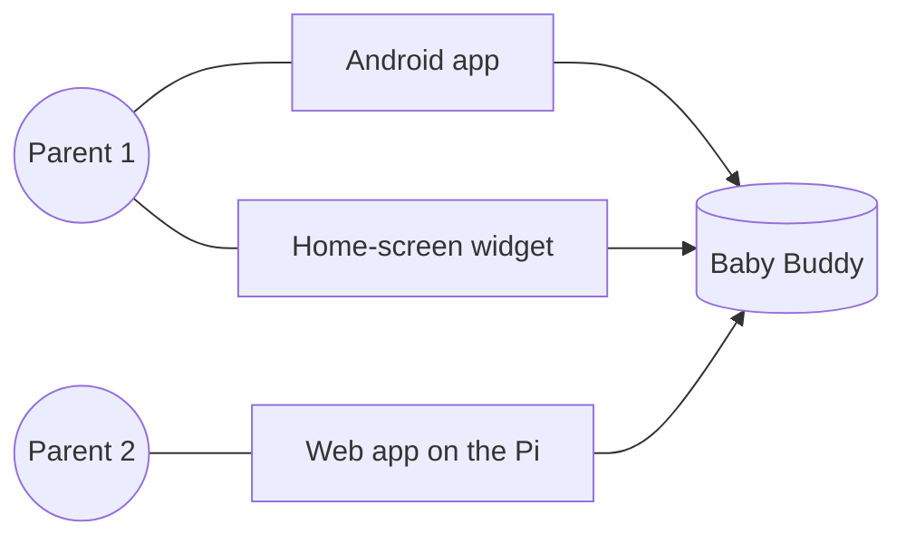
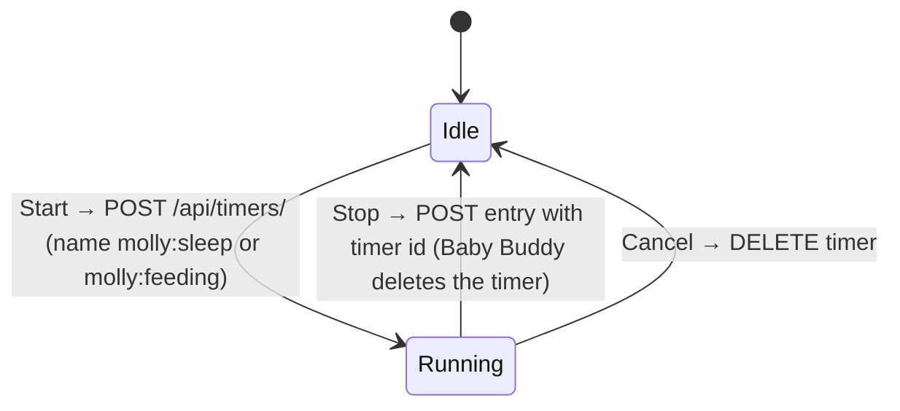
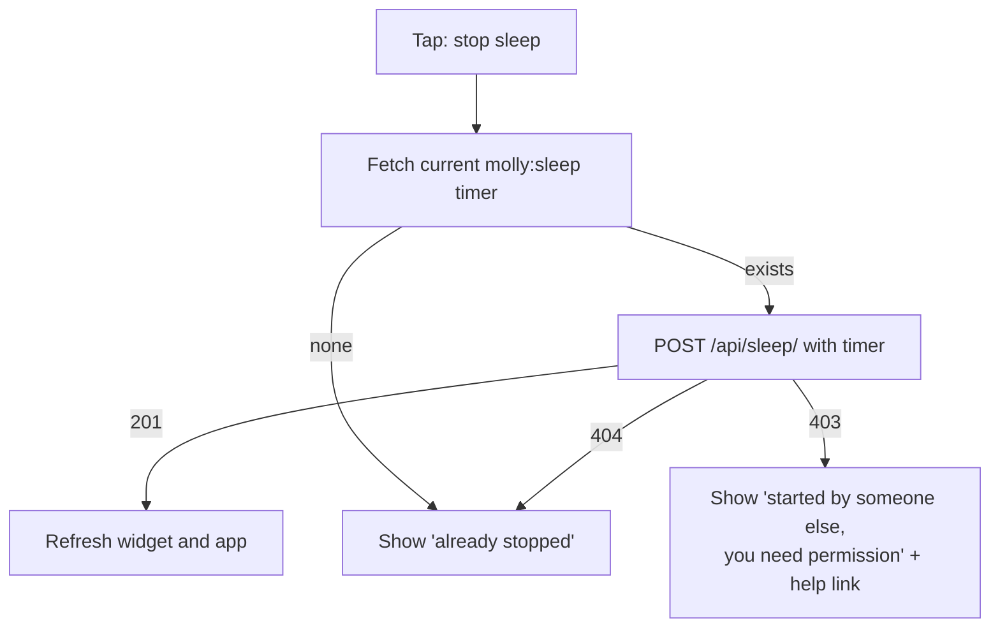
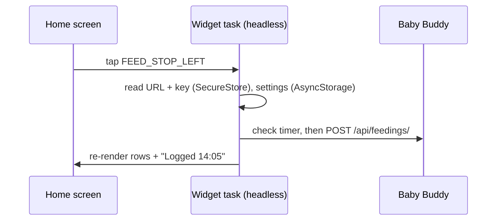
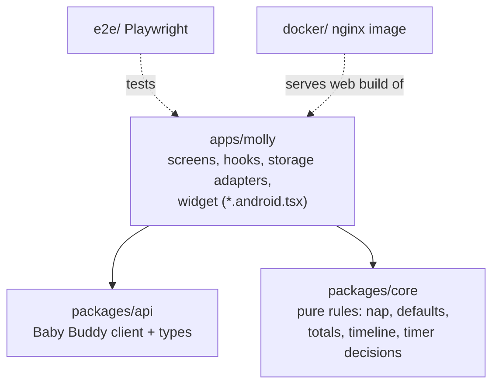
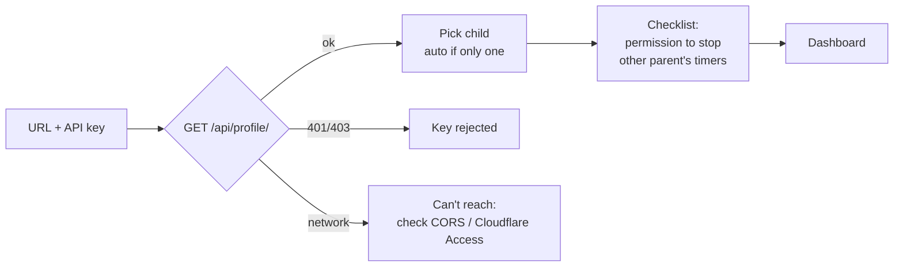
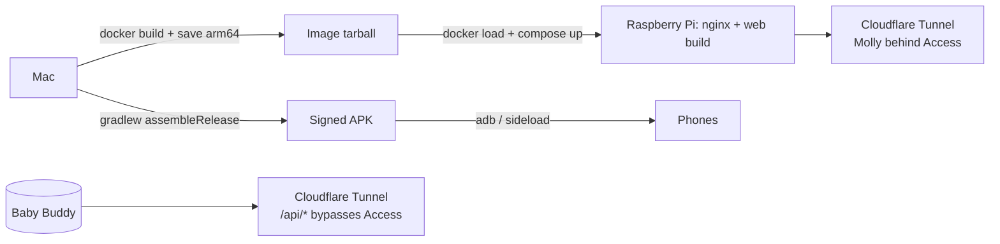
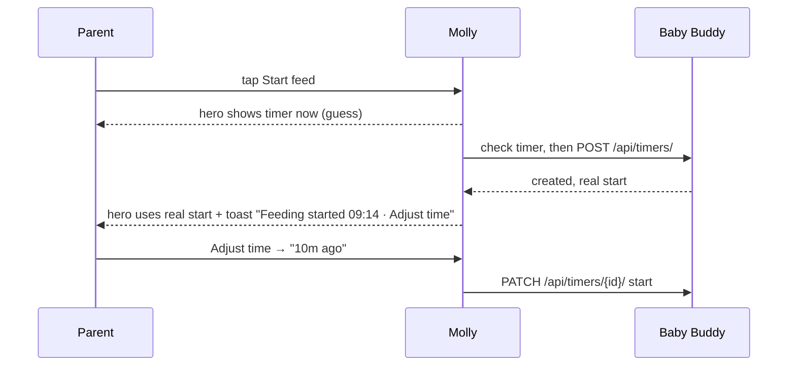
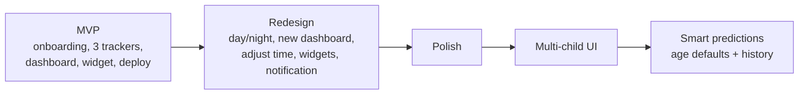

# Molly: mental model

The picture to hold in your head. [`MAIN.md`](MAIN.md) has the full detail.

## 1. Molly is just a remote control

Molly stores nothing of its own. Every tap is an API call to your Baby Buddy, and Baby Buddy is the only source of truth.

Each parent has their own Baby Buddy user and API key. No Molly server, no proxy, no sync service.

## 2. What lives where

| Where | What |
| --- | --- |
| Baby Buddy | All entries, running timers, children |
| Phone: SecureStore | Baby Buddy URL, API key, "my user id" |
| Browser: localStorage | The same, for web |
| Device: AsyncStorage | Settings (bottle type and amount, nap window, child) and the widget's last snapshot |

Settings are **per device**. The two parents can set them differently.

## 3. Timers are the shared state

Sleep and feeding use Baby Buddy **timers**. A running timer is visible to both parents, so either one can stop it.

Diaper changes are instant, so there's no timer: one POST per change.

## 4. Every tap says what it means

Taps say **start** or **stop**, never "toggle". Before acting, Molly checks what Baby Buddy says right now.

So a stale widget can never make a wrong write. At worst it shows "already stopped".

## 5. One tap fills in the rest

| Button | What gets logged |
| --- | --- |
| Stop sleep | `nap` = true if sleep started inside the daytime window (default 07:00–19:00) |
| Feeding: Left / Right | `breast milk` + `left breast` / `right breast` |
| Feeding: Bottle | `bottle` + your default type + your default amount (ml) |
| Diaper: Wet / Dirty / Both | `wet` / `solid` / both |

Everything can be edited later in the app: amount, method, nap, times, color, notes, tags (e.g. "mixed").

## 6. How fresh is what you see?

Baby Buddy can't push updates, so each surface decides when to re-check.

| Surface | Refreshes when… | Worst-case staleness for the *other* parent's actions |
| --- | --- | --- |
| App or web, dashboard open | focus, foreground, every 30 s | about 30 s |
| Widget | you log in the app, open the app, tap the widget, every 30 min | about 30 min |
| Lock-screen notification (redesign) | same moments as the widget, plus any start or stop on this phone | until this phone's app or widget next looks |

If the widget can't reach Baby Buddy, it keeps showing its last snapshot, labelled "not updated since HH:MM".

## 7. The widget runs without the app

A widget tap wakes a **headless** JavaScript task. There's no screen, no React and no app state: just credentials, settings and the API client.

That's why the API client and domain rules live in plain TypeScript packages with no React.

## 8. Code shape

`core` has no I/O. `api` has no UI. Only `apps/molly` knows about React.

## 9. Getting a parent set up

Molly can't check that permission itself. It explains it once, then gives a clear message if a stop fails.

## 10. Deployment

Baby Buddy needs `CORS_ALLOWED_ORIGINS` to include Molly's web address. The signing keystore lives outside the repo and is backed up. If you lose it, you can't update the installed app.

## 11. A tap feels instant, the server still decides

From the redesign on, the screen changes the moment you tap, using the phone's clock. Baby Buddy's answer then replaces the guess.

If Baby Buddy says "already running", "already stopped" or fails, the guess is dropped and the toast says why. "Adjust time" also works after a stop (moves the end) and a diaper log (moves the time). Times never go into the future.

## 12. Day, night and the widgets

The theme follows the phone, or a Day / Night choice made in the app header. Widgets follow the same choice.

| Widget | Sizes it adapts to |
| --- | --- |
| Molly (all three) | 2×1 glance → 4×2 → 4×3 |
| Sleep, Feeding, Diaper | 1×1 one button → 2×1 → 2×2 with timer |

Widgets can't tick, so they show when a timer started. The lock-screen notification is the live, ticking timer, with Stop (sleep) or Left / Right / Bottle (feeding) that work without opening the app.

## 13. Roadmap

The MVP is detailed in [`phases/mvp/MAIN.md`](phases/mvp/MAIN.md), the redesign in [`phases/redesign/MAIN.md`](phases/redesign/MAIN.md). Each starts by proving its riskiest native piece: the MVP the headless widget, the redesign the lock-screen notification's headless actions.
