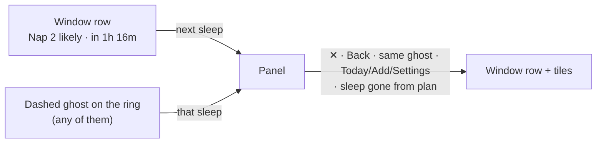
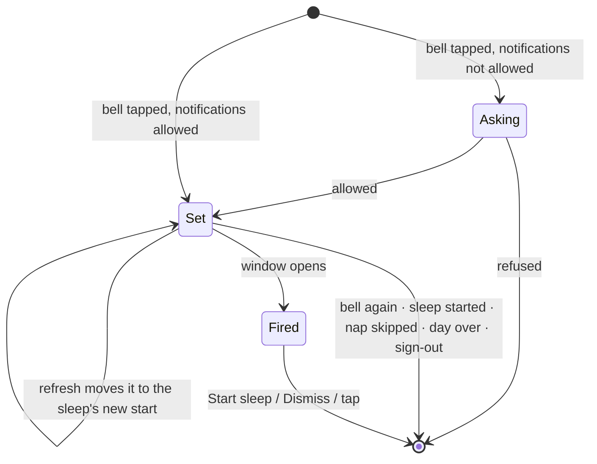
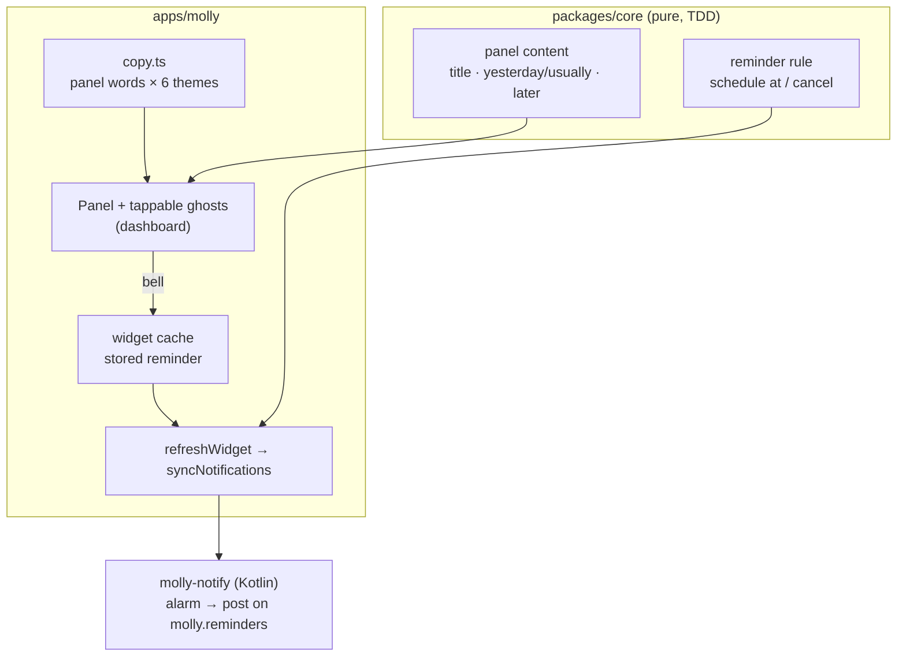

# Likely sleep panel: the picture

Full detail in [`MAIN.md`](MAIN.md). This page is the short version.

## In one sentence

Tap a likely sleep and the tiles give way to a panel about that sleep, worded in the theme's voice, with a bell that reminds this phone when the window opens.

## Where you tap



The panel sits where the editor sits. Panel and editor never show together: opening one closes the other. The tapped ghost fills in on the ring; everything else dims.

## What the panel holds

```
┌──────────────────────────────────────────┐
│ [☾]  Nap 2 likely                     ✕  │  title (themed)
│      12:56 – 13:26 · in 1h 16m           │  times (always literal)
│ Yesterday              13:05 · 1h 05m    │  same slot, last day
│ Usually                13:08 · 1h 05m    │  median over past days
│ ──────────────────────────────────────── │
│ ◌ Then nap 3            15:20 – 15:50    │  rest of the plan
│ ◌ Bedtime               18:30 – 19:00    │
│ Later times shift… · not medical advice  Why ›
│ [🔔]  [ ☾ Start sleep ]          Skip    │  bell Android only
└──────────────────────────────────────────┘
```

- **Why ›** and **Skip** used to live on the window row. Now they live here, and only for the next sleep (Skip: next nap only).
- Rows with no data drop out. While a sleep runs: no Start sleep, no Skip.

## Words: what themes may change

Labels change per theme. Numbers never do.

| Themed | Always literal |
| --- | --- |
| Title, Yesterday / Usually, later names, bell, Skip, Why, Start sleep | Clock times, durations, `in 1h 16m`, the disclaimer, the notification |

Same sleep, three voices:

| Classic | Terminal | Safari |
| --- | --- | --- |
| Nap 2 likely | $ inspect nap_2 | Lion nap 2 coming up |
| Usually | median | Most days |
| Bell (icon) | ping 12:56 | Roar at 12:56 |

Playful labels off → Classic in every theme. Screen readers always hear Classic.

## The reminder's life



- **Stored as which sleep, not which time.** "Nap 3 today" stays nap 3 even when a log moves it.
- **One per child, this phone only.** The other parent's phone knows nothing about it.
- **Same channel and permission rules as the Vitamin D reminder**: silent, shows on the lock screen.
- **Alarm is inexact**: can be a few minutes late when the phone is idle; no extra permission.

## Where the code goes



## Order of work

1. Core panel content → 2. theme words → 3. panel and ghosts (web e2e) → 4. core reminder rule → 5. native reminder and bell → 6. look review and wrap-up.
