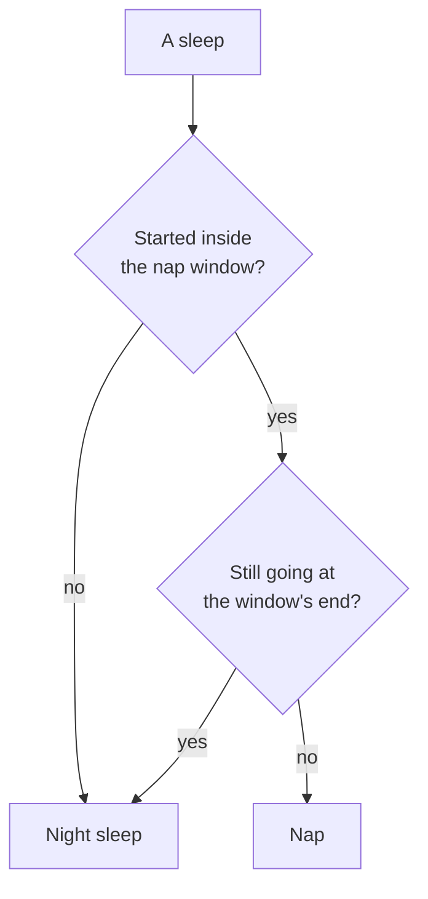
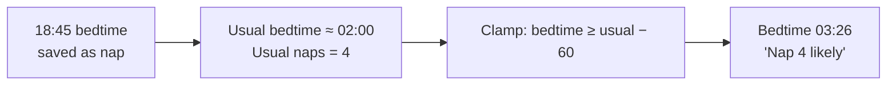
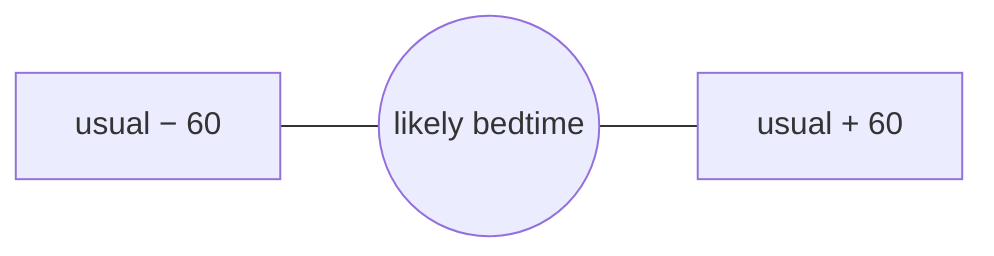

# Nap or night: mental model

## The one idea

Whether a sleep is the night is decided by **when it happened**, not by a saved yes/no. One rule, used by the ring, the plan and saving.

With a 07:00–19:00 window: `18:45 → 02:00` is night, `18:00 → 18:40` is a nap, `06:30 → 07:30` is night.

## Why bedtime said 03:26

Old bedtimes at 18:45 were saved as naps (they started before 19:00). The plan looked for the first sleep *not* saved as a nap and found the 02:20 stretch after a night waking.

The fix: the plan finds bedtime by the rule above and ignores the saved flag. Old data is then read correctly without touching it.

## The second cause: an invented nap

Even with clean data the plan said 22:06. The "usual number of naps" check skipped the first planned sleep, so after nap 3 it added a 4th nap and a full wake window after it.

Fix: check the count from the first planned sleep. A day with 3 usual naps goes straight to bedtime after nap 3.

## Bedtime is fenced in

Bedtime never starts more than an hour from the child's usual bedtime, either way. The usual bedtime is the child's own median, never a fixed clock.

## Short naps → earlier bedtime

The guides agree: after poor naps, put the baby down earlier (no study says by how much).

- **Shortfall** = how much shorter today's naps were than usual for their slots.
- Bedtime moves earlier by **half** the shortfall.
- Together with skipped naps: at most **60 min** earlier, and never before the shortest sensible last wake window.

Example: naps 40 + 35 + 45 min where 60 + 60 + 45 is usual → shortfall 45 → bedtime 22 min earlier.

## Saving and editing

| Moment | What happens |
| --- | --- |
| Stop (app, widget, lock screen) | Rule with the real end → saved as nap or night. |
| Add entry | Rule with the entered times. |
| While running | Words show what stopping now would save. |
| Edit | `Nap \| Night sleep` choice; fixes old wrong ones by hand. |

Labels of saved sleeps keep showing what was saved.

## What does not change

- Labels of saved sleeps come from Baby Buddy's flag.
- No fixed clock limit on bedtime, no age rule against a 4th nap.
- Nothing already in Baby Buddy is rewritten automatically.
