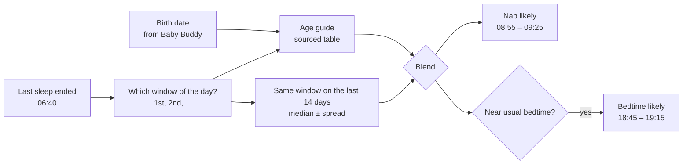
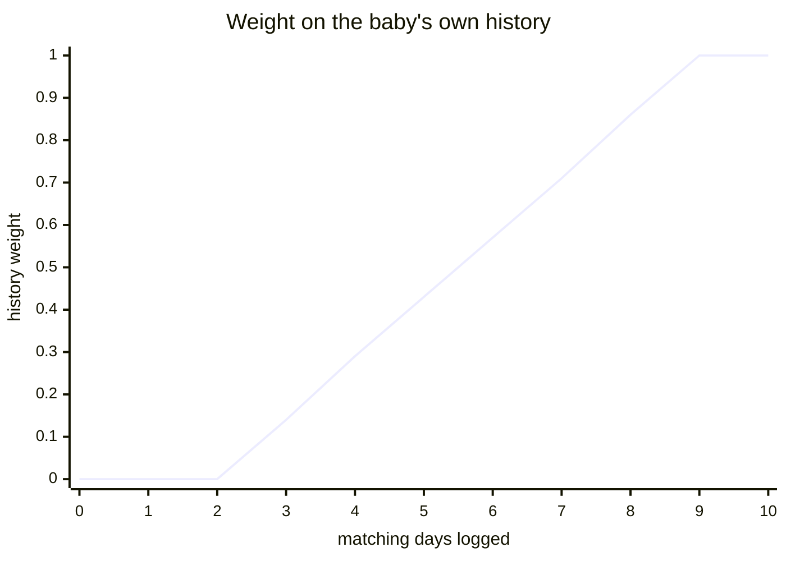
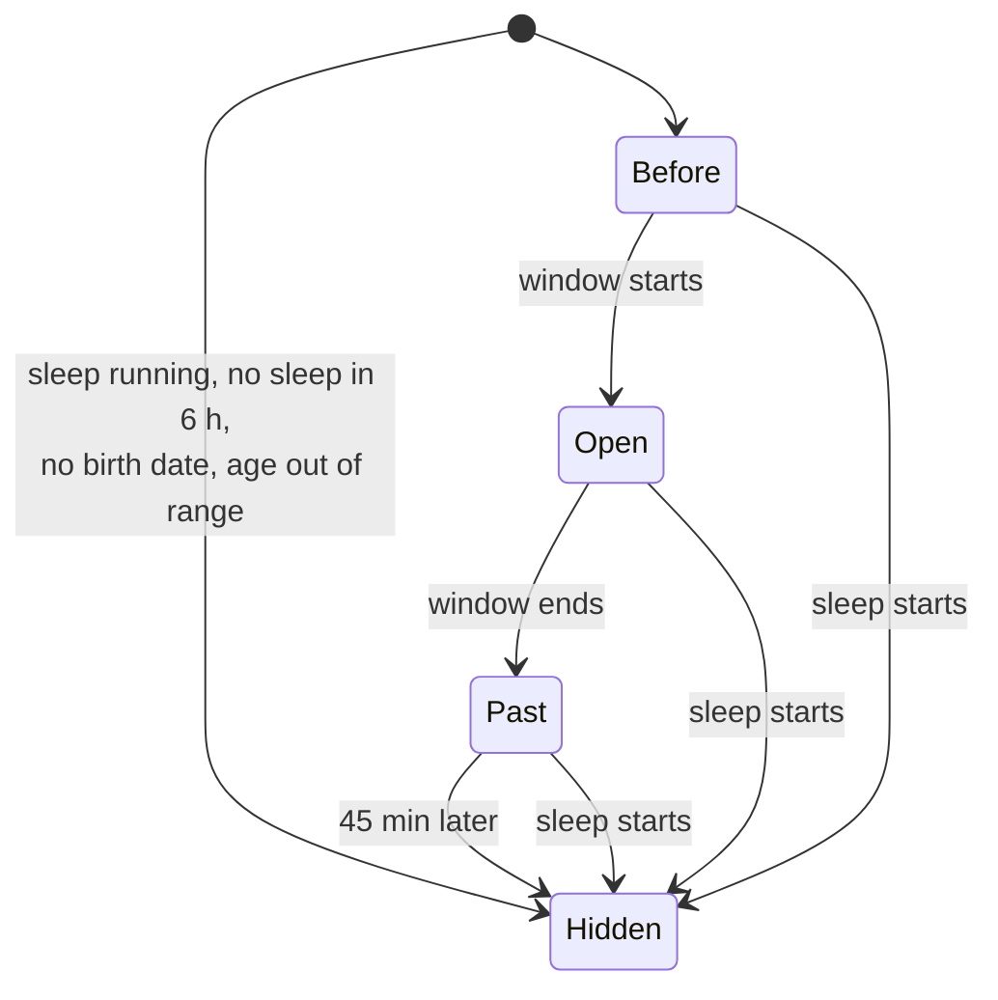
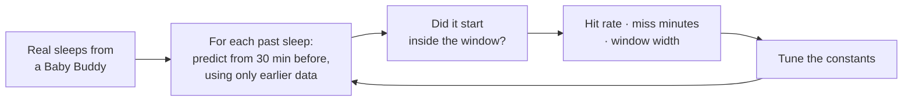
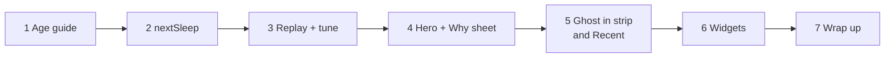

# Next-nap prediction: the mental model

## In one line

While the baby is awake, Molly guesses **when the next sleep is likely** and shows it as a window: `Nap likely 08:55 – 09:25`. It predicts only the next sleep, and it computes everything on the phone, so Baby Buddy is never changed.

## Where the window comes from

Two ingredients. The **age guide** is a general range for babies this age. The baby's **own history** is how long they actually stayed awake before the same nap on recent days. History is what makes it accurate. The guide covers the start, when there's no history yet.

## How much each counts

Under 3 matching days, the age guide alone: the hero says "Based on age (4 months) only". From 3 days on, history counts more with each day, and fully from 10. The replay (below) may move these numbers.

## The age guide is honest about its limits

No study has measured "wake windows by age". The popular tables come from pediatrician-reviewed guides, not data. What *is* measured is naps per day and hours of day sleep by age (Galland 2012, Iglowstein 2003, Mindell 2016).

So the table uses the guides' ranges, checked against those studies. Awake time per day divided by (naps + 1) lands inside the guide's range at every age where the studies give data. The sources are in `NOTES.md`.

## What the hero shows

| State | Label on the bar |
|---|---|
| Before | `Nap likely 08:55 – 09:25` · `Opens in 25m` |
| Open | … · `Window open` |
| Past | … · `Past the window` (neutral colour, never red) |
| Hidden | no bar, just "Awake for" as today |

"Awake for 2h 34m" stays the big number (design 1a). The bar under it fills with awake time over a band marking the window. Under it: `Estimate · not medical advice · Why ›`, which opens a sheet showing where the window came from.

## Where else it shows

- **Today strip:** a dashed sleep block where the window is.
- **Recent:** a dashed `08:55 Nap likely until 09:25` row at the top. It isn't an entry, and tapping does nothing.
- **Widgets:** clock times only (`nap 08:55`, `Nap 08:55 – 09:25`). A widget can be 30 min stale, so "opens in 25m" would lie.

## The replay makes it actually work

Before any screen is built, a script replays real logged days. For each past sleep, it asks "what would Molly have said?" and scores the answer. The spread, the history length, the blend and the catnap cutoff are tuned until the hit rate is good and the window stays narrow enough to be useful. It reads a real Baby Buddy, read-only, with a key kept out of git.

## The steps

Steps 1–3 are pure logic, test-driven. Steps 4–6 are screens, checked with Playwright and by eye.

## Not in this work

- The "remind me when it opens" notification (needs new native scheduling, planned later).
- Next feed, wake-up time, night wakings, a whole day's schedule.
- Editing the age guide.
