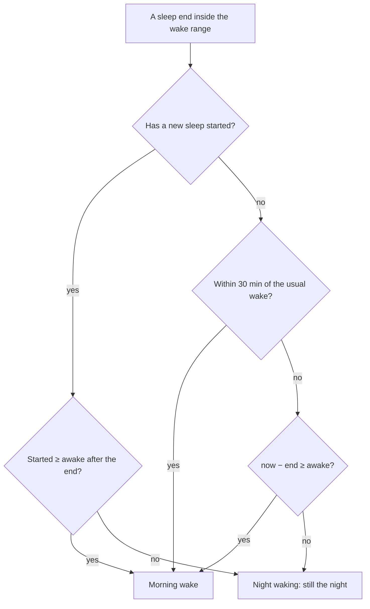
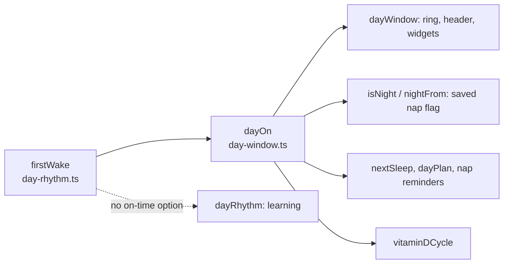

# Mental model: the day starts at once on an on-time wake

## The problem in one line

A wake right at the usual time waits 40–75 min before the screen shows the day. That wait is only needed for early wakings.

## Before and after

Learned wake 08:08, 3–6 month band (60 min awake). The night ends 08:05.

```
          08:05 wake      08:08                     09:05
before    │── Tonight ─────────────────────────────▶│ Today (from 08:05)
after     │ Today (from 08:05) ─────────────────────────────────▶
```

The day still starts at 08:05 in both cases. The only change is when the screen shows it.

## The decision



Only the "within 30 min" box is new. Everything else is how `firstWake` already works.

**Usual wake** is the learned wake, or "Day starts" until one is learned. An early wake near "Day starts" after a wake is learned still takes the threshold path.

## Back to sleep soon after: the undo

```
08:05 wake (on time) ──▶ Today
08:15 asleep again   ──▶ 10 min < awake → 08:05 is no longer the wake → Tonight
                         the 08:15 sleep is saved as night
08:35 wakes          ──▶ on time again → Today from 08:35, at once
   or 09:30 wakes    ──▶ not on time → Tonight until 10:30, then Today from 09:30
```

Nothing is stored. Each render looks at the sleeps again, and once the 08:15 sleep exists, 08:05 fails the "next sleep" check.

## A nap, not an undo

```
08:05 wake ──▶ Today
09:20 asleep (75 min later, past awake) ──▶ first nap, Today stays from 08:05
```

The line between undo and nap is the band's `awake`, not the predicted first nap.

## Where it lives



`dayOn` passes the usual wake. Learning doesn't, so the learned wake never feeds on itself. On past days the old and new rules give the same answer anyway, because the next sleep is known.

## What follows for free

- **The nap flag**: a sleep soon after an on-time wake is saved as night, through the same `dayOn`.
- **Vitamin D**: stopping the night on time opens today's cycle at once, so the reminder can come right at that stop.
- **The plan**: the first nap shows right after the wake, instead of an hour later.
