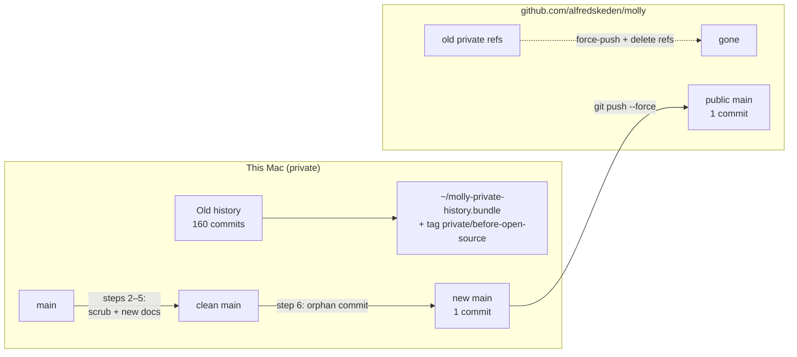
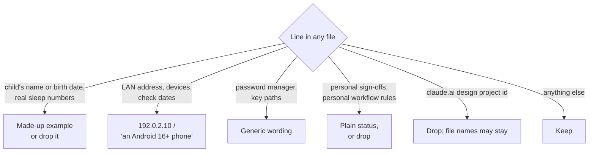
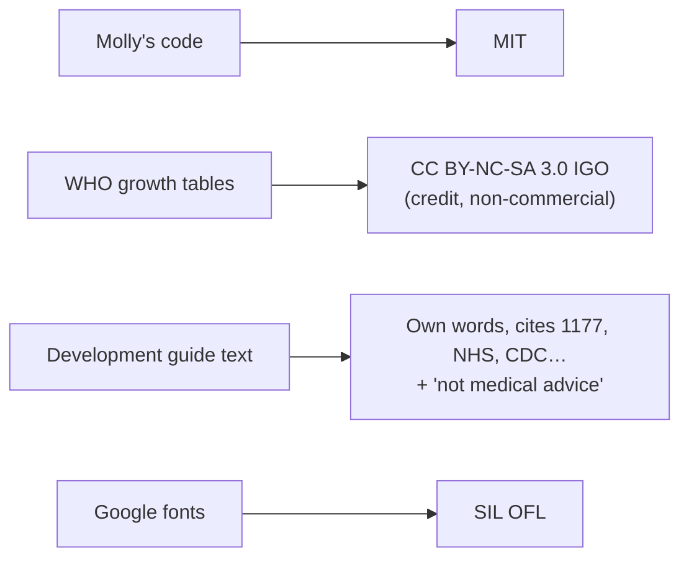

# Open-source Molly: mental model

## The one-line version

Clean the tree, save the old history locally, publish the clean tree as **one new commit** over the existing GitHub repo, then make it public.

## Where everything ends up

The old history never leaves the Mac again. On GitHub, only the single new commit is reachable.

## Why one fresh commit

Old commits still hold a personal email on every commit, Playwright trace zips and every past version of the notes. Rewriting all of that safely is hard. A new snapshot commit can't leak the past because it has none.

The repo was never public, so nobody has a fork or a copy to worry about.

## What counts as personal

Anything that points at the family or the home, not at the project:

What stays on purpose: the owner's name (GitHub account, Android id `se.skedeback.molly`) and the made-up test names Otto, Ella and Mia.

## The six steps

| # | Step | Touches |
| --- | --- | --- |
| 1 | Back up history | bundle + local tag, outside the repo |
| 2 | Scrub code | comments, test fixtures, logo SVG, build doc; no behaviour change |
| 3 | Scrub plans | every file in `plans/`, including HTML and the design export |
| 4 | Agent + contributor files | `CLAUDE.md` loses its progress diary (→ `plans/README.md`); new `CONTRIBUTING.md`, `SECURITY.md` |
| 5 | Public docs | `LICENSE` (MIT), `THIRD_PARTY.md`, README rewrite, `docs/` for strangers |
| 6 | Check + publish | done-checks, noreply identity, orphan commit, force-push, GitHub settings, fresh clone |

Steps 1–5 are reversible commits on the private `main`. Step 6 is the only one that can't be undone, and it starts only on an explicit go-ahead.

## Licenses in one picture

`THIRD_PARTY.md` says all of this, so nobody assumes MIT covers the WHO data.

## Accounts and identity

- Commits from step 6 on: `605500+alfredskeden@users.noreply.github.com`, set in this repo only. Committing and pushing from this Mac work as before.
- GitHub settings are changed as `alfredskeden`, never as the work account that `gh` also knows.
