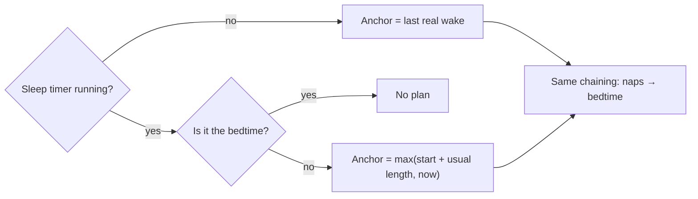
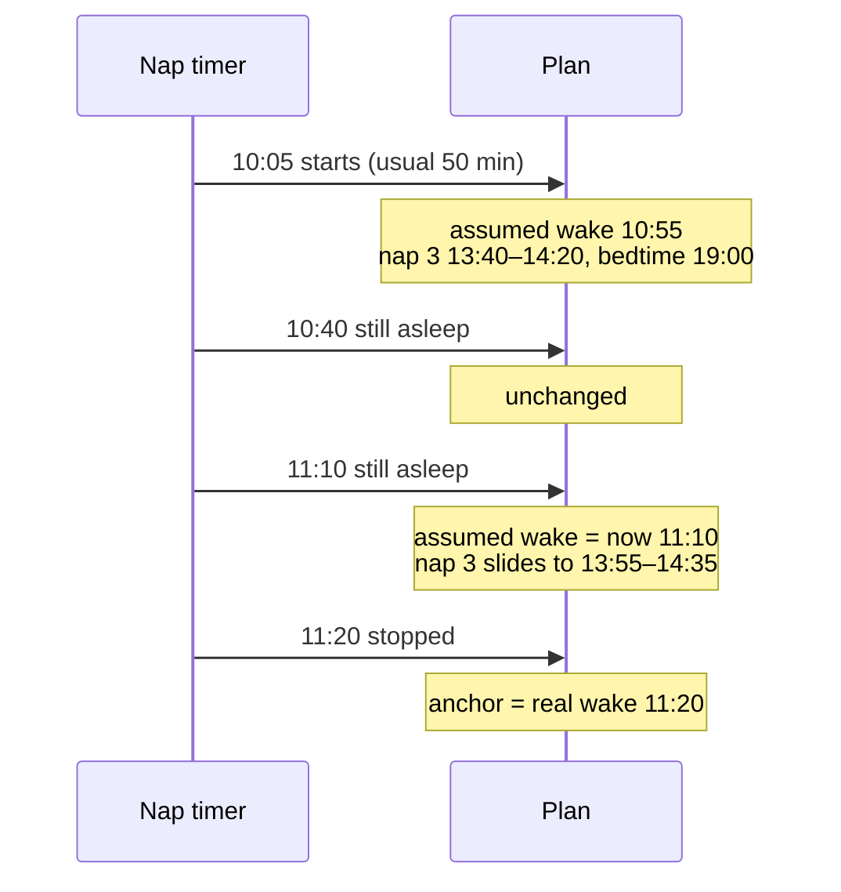

# Plan while asleep: mental model

## The one idea

A running nap is treated as a nap that will end at its usual length. The rest of the day is planned from that assumed wake, exactly as if the baby were awake.

## When does the plan move?

Only when the rule's inputs change. A normal nap moves nothing; a long one pushes everything later, minute by minute; stopping snaps to the real wake.

## Is it the bedtime?

Yes if the day window already says night with it running, or if the plan just before it started had bedtime next. Then nothing is drawn after it, as today.

## What shows where

- **Ring:** ghosts for the sleeps after the running one. The running arc stays as it is.
- **Window row:** the next sleep after the running one. No Skip while asleep; Skip comes back at stop.
- **Feeding:** no longer hides anything.
- **Widgets and notification:** unchanged, no next sleep while sleeping.

## Small consequences

- Skips tapped before the nap stop counting once it runs.
- A sleep stopped under 15 min is a catnap: the plan goes back to the previous wake.
- While asleep, the live day ends at the likely bedtime, as when awake.

## Where it lives

`sleepContext` in `packages/core/src/next-sleep.ts`, so `nextSleep` and `dayPlan` stay in step. Dashboard gating in `apps/molly/src/app/(main)/index.tsx`. Widget refresh hides it itself in `src/widget/model.ts`.
