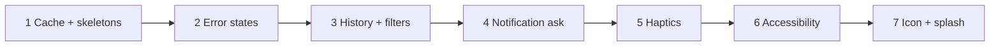
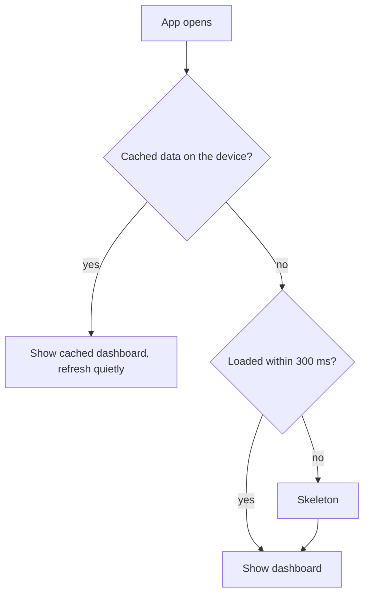
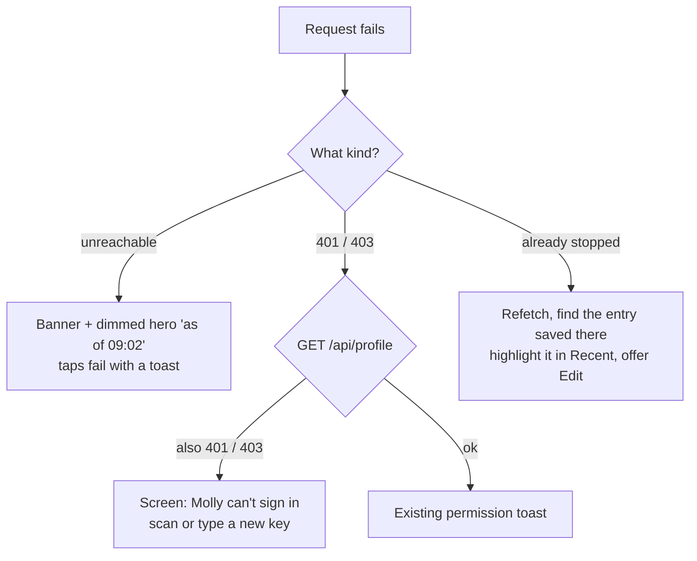
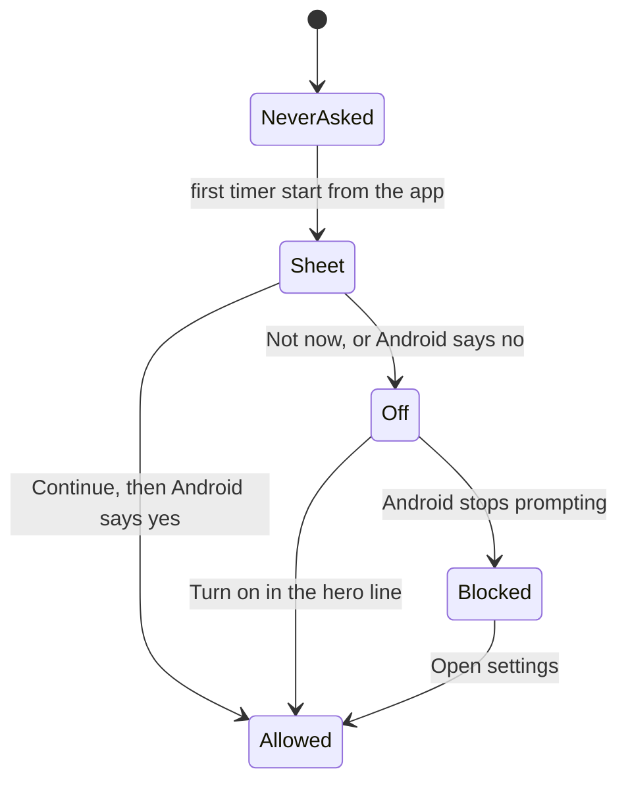

# Polish: mental model

The authoritative plan is [`MAIN.md`](MAIN.md). This is the short version, picture first.

## What changes

Seven small upgrades on top of the shipped redesign. Most of the logic stays the same; this is about how the app behaves at the edges: while loading, when something fails, and for people using TalkBack or large fonts.

Each step ships on its own. Accessibility comes late so it can sweep the new screens too, but new screens follow its rules from the start.

## Opening the app

The cache is what makes a cold start instant. Before this plan, nothing survived a restart.

During a skeleton, Diaper and Medication already work, because they don't depend on server state. Sleep and Feed wait, because Start or Cancel depends on the running timers.

## When a request fails

The key rule: **a 403 isn't always a bad key.** Baby Buddy also sends 403 when your user lacks a permission. Molly asks `/api/profile` before it decides.

The invalid-key screen keeps the server address and child. Only the key is asked for again.

From a widget or the lock screen, the app can't open itself in the background. The widget and notification change to "Can't sign in · Open Molly" instead, and the parent's tap opens the screen.

## History

"See all" under Recent opens History: entries grouped by day, seven days at a time.

- Chips: All, Sleep, Feed, Diaper, Med. Tap several to combine; All resets.
- Filtering happens on the phone. The choice is remembered per device.
- Each day header sums what's showing ("7h 40m sleep · 4 feeds").
- Empty because of a filter: say so, name the last matching entry, offer "Show everything".

## Asking for notifications

Not during onboarding. The first time a timer starts, when the lock-screen timer is actually useful.

While it's Off or Blocked, a running timer's hero shows one quiet line with "Turn on". Turning the Lock screen setting off in Settings stops that line.

## Haptics

Four strengths, one meaning each:

| Strength | Means |
| --- | --- |
| Medium | a timer started |
| Success | something saved with a duration |
| Light | quick one-tap logs, cancels |
| Selection | a choice or step changed, nothing saved |
| Warning / Error | "are you sure", "already", nothing saved |

They fire on the optimistic update. If the server then refuses, the error haptic follows with the toast. Android only, respecting the system's touch feedback setting, with a Settings toggle.

## Accessibility

The design's audit is the checklist: ten findings, fixed in shared components so every screen gets them. The four big ones:

- **Today strip**: marks too faint in Day, meaning by colour only → row labels, one spoken summary, darker marks.
- **Ticking timers**: never announced every second; spoken as "Feeding for 12 minutes".
- **Roles**: tiles, chips and rows become buttons and radios with state.
- **Large fonts**: no fixed heights; the hero timer stops growing at 1.4×.

A test computes the contrast pairs from the tokens, so a colour change can't quietly break them.

## Icon and splash

The icon is the Today strip itself: four coloured rows on dark ink, with the now line. One SVG is the source, and a script renders every PNG.

The splash uses the Day or Night background. The tricky part: Android draws it before any JavaScript runs. Molly tells Android its night mode whenever the theme preference changes, so a night feed never flashes a light screen.

## Not in this plan

- The Cloudflare Access "sign-in expired" screen (it stays "Can't reach").
- Multi-child, predictions, background polling.
- New layouts for settings, onboarding, help or edit.
