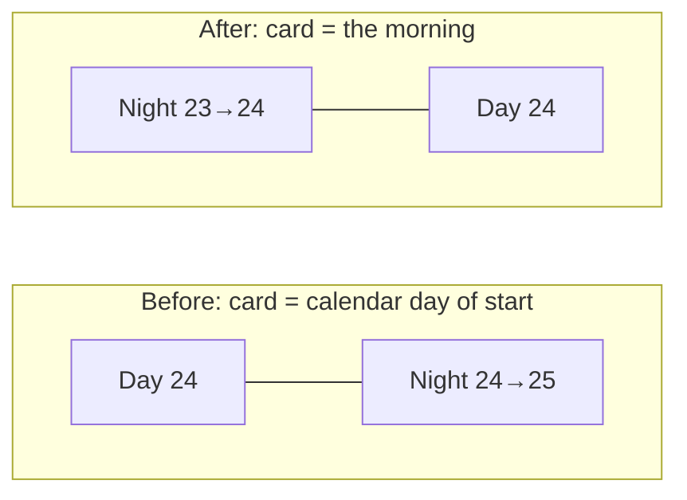
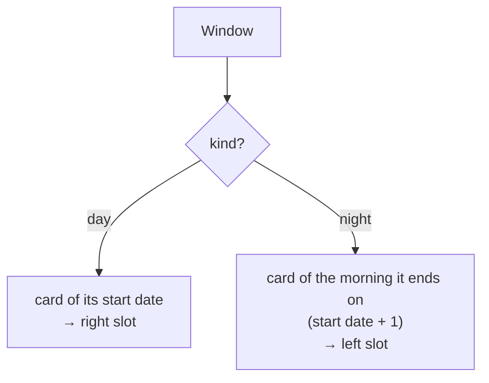

# Recent days: night, then day

## The idea in one line

A card is **one morning**: the night the baby woke from on the left, the day that followed on the right.

## Before and after



The night moves from the evening's card to the next morning's card.

## Which card a window lands on



## What the list looks like

Daytime (day is live):

```
┌ Today ────────── Thu 24 Sep ┐
│ (Night)        (Today so far)│
└──────────────────────────────┘
┌ Yesterday ────── Wed 23 Sep ┐
│ (Night)        (Day)         │
└──────────────────────────────┘
```

Evening (night is live): Tonight has no day after it yet, so it gets its own card.

```
┌ Tonight ──────── Fri 25 Sep ┐
│ (Tonight)      ·  empty      │
└──────────────────────────────┘
┌ Today ────────── Thu 24 Sep ┐
│ (Night)        (Day)         │
└──────────────────────────────┘
```

## Slots are fixed

Night is always left, day always right. A missing half stays empty (Tonight alone; the oldest loaded day before its night is fetched), so the rings line up down the list.

## What doesn't change

Mini rings, totals, labels, tap-to-open, `Load 3 more days`, and the dashboard's own cap / pair switching.
