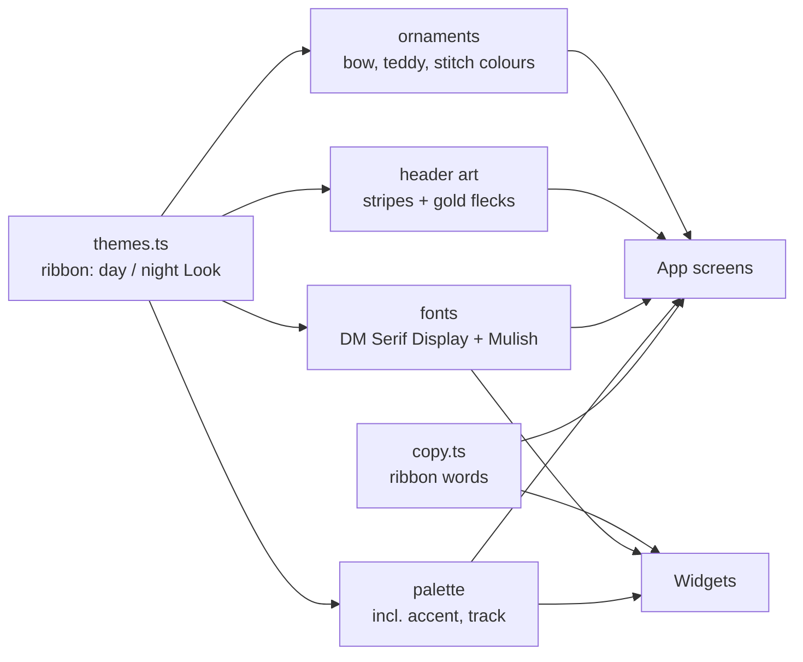
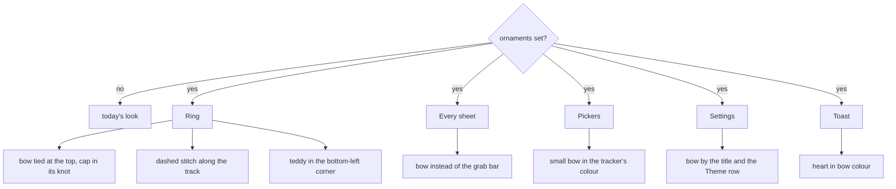
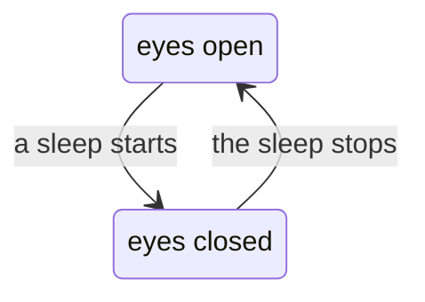
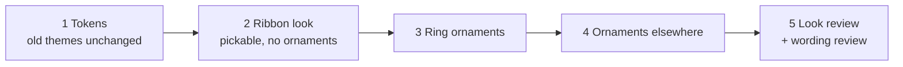

# Ribbon theme, in pictures

## What it is

A seventh theme. Same app, same layout, new look: dusty rose by day, plum with gold flecks by night. Three ornaments make it Ribbon: a **bow**, a **teddy**, a **stitch**.

Other themes don't change.

## Where the look comes from

Widgets get colours, fonts and words. No ornaments, no header.

## Two new kinds of setting

**Tokens every theme has now.** `accent` (primary buttons), `on-accent` (text on them), `track` (the ring's track). Old themes set them to what they already used (`ink`, `bg`, `line`), so they look the same. Ribbon sets rose.

**A slot only Ribbon fills.** `ornaments` is empty for every other theme. Screens ask "is there a bow?", never "is this Ribbon?". Another theme could fill it later.

## Where the ornaments show up

## The teddy's eyes

It fades with the rest of the ring while you edit an entry.

## Order of work

Each step ships on its own with `pnpm check` green.

## Words

The design names one label: **Sweet dreams** while asleep. The rest get drafted in that soft tone and reviewed. Screen readers, History and errors keep plain words, as in every theme.
