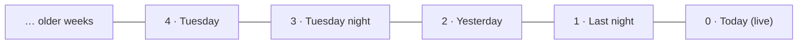
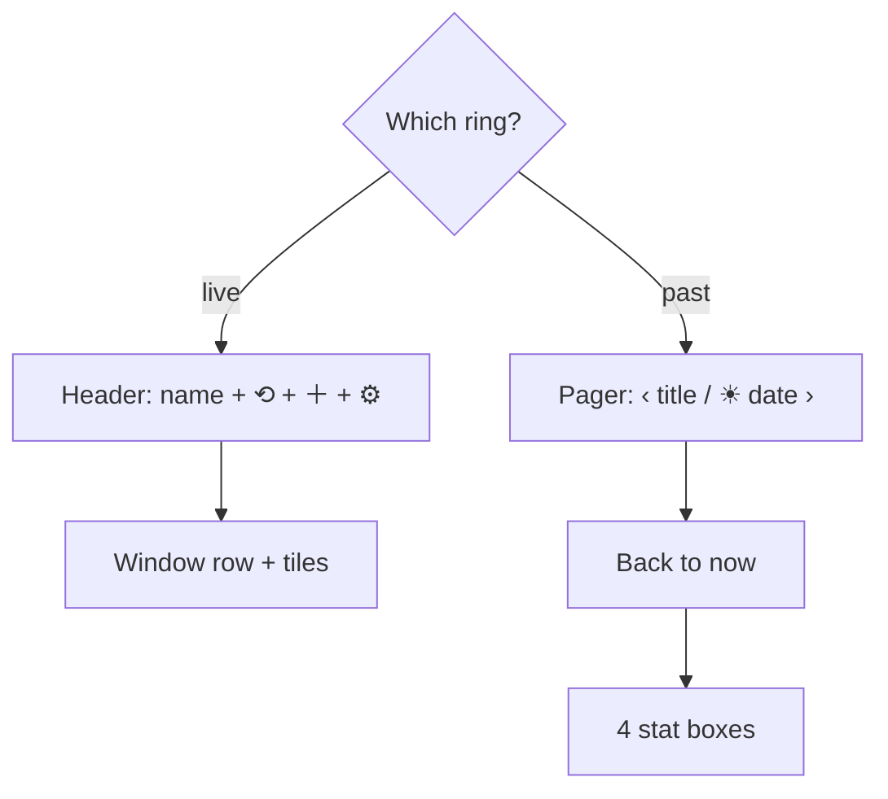
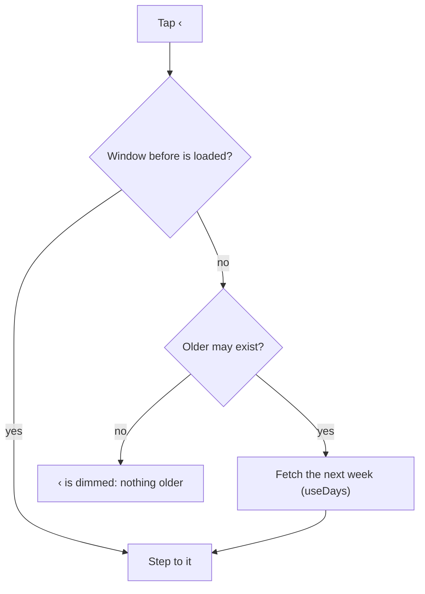
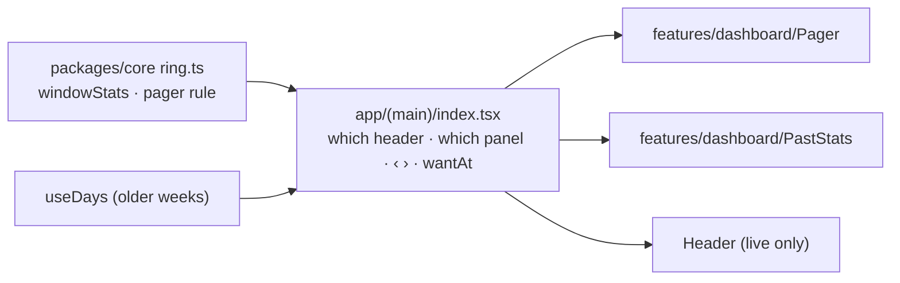

# Mental model: stepping between rings

The full plan is [`MAIN.md`](MAIN.md). This page is the picture.

## In one line

A past ring gets a pager header (`‹ title ›`) and four stat boxes; the live ring stays exactly as it is.

## Windows in a row

The dashboard already knows every window as a list, live first, newest to oldest. The pager just moves one step along it.

- `‹` goes right in this picture (older, index + 1). `›` goes left (newer, index − 1).
- Day and night alternate, because the list does.
- The sun/moon cap still jumps to the other half of the same pair, so it skips around instead of stepping.

## What the screen shows

On a past ring, tapping an entry still opens the editor in place of the boxes, as it does in place of the tiles.

## The right-hand button

| Shown ring | Right button |
| --- | --- |
| Newest past ring (index 1) | Ink pill `Today ›` or `Tonight ›`, goes live |
| Any older ring | `›`, one step newer |

## How far back `‹` goes

"Older may exist" means a loaded entry is older than the shown ring, or the oldest week Baby Buddy sent wasn't empty. It's the same rule as Recent days' `Load 3 more days`.

## The stat boxes

| Ring | Box 1 | Box 2 | Box 3 | Box 4 |
| --- | --- | --- | --- | --- |
| Day | slept | naps | feeds | diapers |
| Night | slept | feeds | diapers | medicine |

One pure function (`windowStats`, core) counts them. The ring's centre text (`Slept 2h 10m · 3 naps · 7 feeds`) uses the same function, so the two always agree.

## Things that stay

- **Snap back:** idle for 60 s on a past ring, or the app coming back from the background, returns to the live ring. Each step restarts the minute.
- **Android back** on a past ring goes to now, not one step back.
- **Live ring:** header, window row, tiles and predictions don't change.
- **Buttons only:** no swipe.

## Where the code goes

