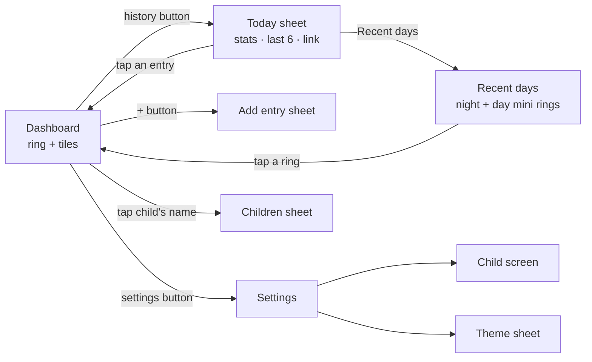
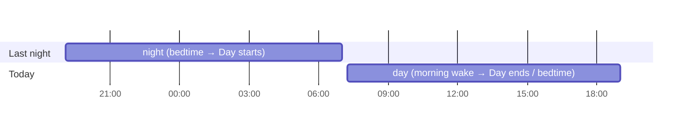
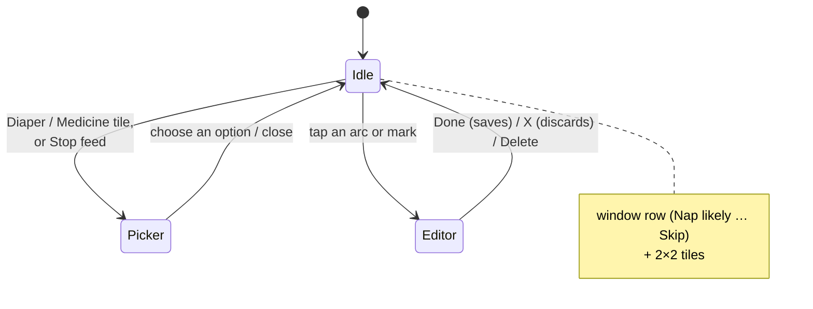
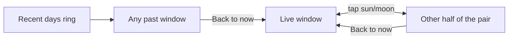
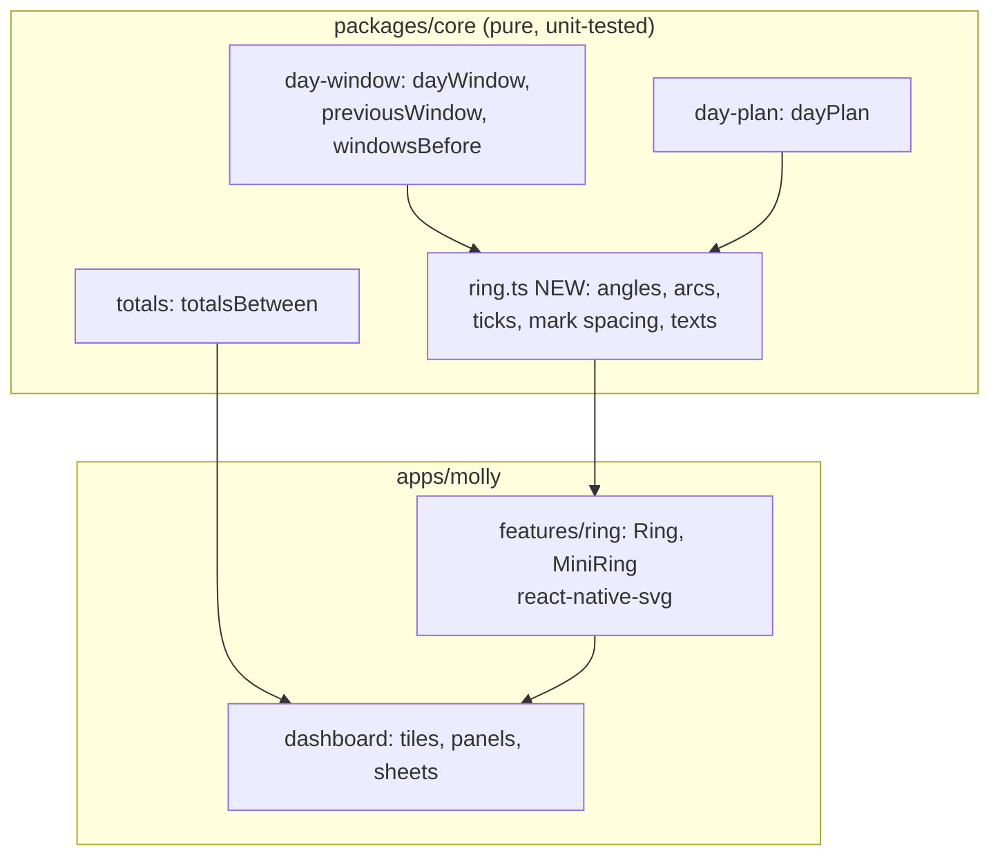

# Ring redesign: the picture

The full plan is [`MAIN.md`](MAIN.md). This page explains it with diagrams. The work was done on the `redesign-ring` branch, since merged into `main`.

## In one sentence

The dashboard becomes **one clock ring of the baby's current day or night**. Everything else (stats, history, editing, adding) moves into sheets and panels around that ring.

## The screens



What goes away: History list, Days screen, the edit screen, the avatar stack and the other-child strip.

## What the ring shows: one window

A window is a day or a night, exactly as Molly already defines them. Nothing changes in the rules, only how they're drawn.



- **Day** = starts at the wake-up closest to "Day starts" and ends at "Day ends" (or the end of the bedtime window from the plan).
- **Night** = starts at bedtime and ends at the next "Day starts".
- "Day starts / Day ends" in the child screen are the nap window you already have, under a new name.

## Anatomy of the ring

```
                 ☀  Day started 07:13        ← cap: tap = other half of the pair
             ╭─────── · ───────╮
        12:56 ┊ dashed = likely ┊ 13:26      ← plan ghosts + time labels (live day, awake only)
          ●  ╱                   ╲  ●        ← marks outside: feed / diaper / medicine
            │    Awake            │
            │    2h 39m           │          ← centre text
            │    since 09:01      │
          ●  ╲                   ╱           
             ╰━━━━ sleep arcs ━━━╯           ← tap an arc or a mark = edit it
                     │ now hand
```

- The ring starts at the 16° mark at the top and sweeps 328°. Its start is the window's start.
- A time's angle is just the fraction of the window that has passed by then.
- Hour ticks fall on whole clock hours.

## Under the ring: one panel at a time



- **Sleep and Feed tiles** start a timer straight away. While one runs, its tile turns dark and reads `Stop …`.
- **Stopping a feed** asks which side: Left, Right, Both or Bottle.
- **Skip** sits on the window row and writes the usual `molly-skip` note. Undo is in the toast.

## Moving through time



There's no swiping. A past window can be tapped and edited just like the live one.

## Where the logic lives



The geometry and the wording are pure functions in core. The app just draws what they return.

## Themes

The design shows Classic only, but all six themes stay. Each theme re-skins the new layout with its colours, fonts, corners, header pattern and playful labels, and Safari keeps its pictures. The ring's geometry is the same in every theme. Themes are picked in the Theme sheet and apply at once. Every other setting waits for **Save changes**.

## Untouched

- Widgets
- Lock-screen notifications
- The prediction rules
- The day / night rules
- Merging into `main`, decided after trying the branch
