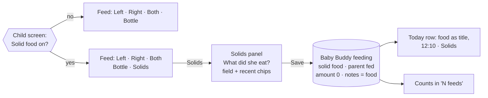
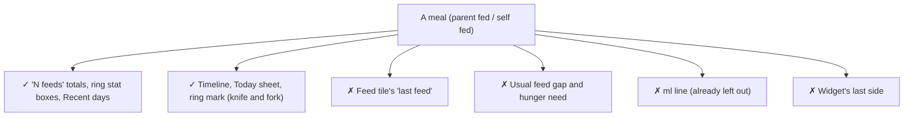

# Solid food, at a glance

A per-child switch adds **Solids** to Feed. A meal is a Baby Buddy feeding whose notes hold the food. There's no amount to set.

## The one picture



## What gets saved

| Field | Value |
| --- | --- |
| type | `solid food` |
| method | `parent fed`, always |
| amount | `0` |
| notes | the food: `Carrot, Porridge` |
| start / end | Time feeds off: one minute ending now. On: the timer's span |

Save stays greyed out until the food field has text.

## The Solids panel

```
┌─────────────────────────────────┐
│ Solids                        ✕ │
│ What did she eat?               │
│ [ Carrot, Porridge           ]  │  keyboard already open
│ (✓ Carrot)(✓ Porridge)(+ Banana)│  five recent foods
│ [            ✓ Save          ]  │
└─────────────────────────────────┘
```

- **Chips** come from this child's own past meals: notes split on commas, each food once, newest first. There's no list to maintain.
- Tapping chips **joins** them ("Carrot, Porridge"). Typing takes over from the chips.

## Whose words

The question names the child unless you've said whether the child is a girl or a boy.

| Girl or boy (child screen) | Question | Editor label |
| --- | --- | --- |
| Girl | What did she eat? | What she ate |
| Boy | What did he eat? | What he ate |
| Not set | What did Ella eat? | What Ella ate |

## Where a meal counts



A lunch doesn't replace milk, so the "last fed" clock keeps following milk. One rule, `isSolidFeed`, makes this split everywhere.

## Where Solids appears

- **App**: the instant Feed picker, the timer's "Stop and save as", the editor's fifth segment, Add entry.
- **Not** on the widget or the lock-screen notification: a meal needs a food typed in.

## Theme words

All themes show the knife and fork icon (`restaurant`).

| Theme | Button and panel title |
| --- | --- |
| Classic, Ribbon | Solids |
| Arcade | Bonus snack |
| Space | Space food |
| Score | Half-time snack |
| Term | solids |
| Safari | Nibbles |
| Life Sim | Meal (toast: "Nom nom!") |

## Good to know

- **The switch is per device.** Each parent turns it on for each child on their own phone, like the bottle settings.
- **Old meals still edit fine** after the switch is turned off: the editor shows Solids whenever the entry is one.
- **Overlaps**: an instant feed never starts before the previous feeding's end, meals included, because Baby Buddy refuses overlapping feedings.
