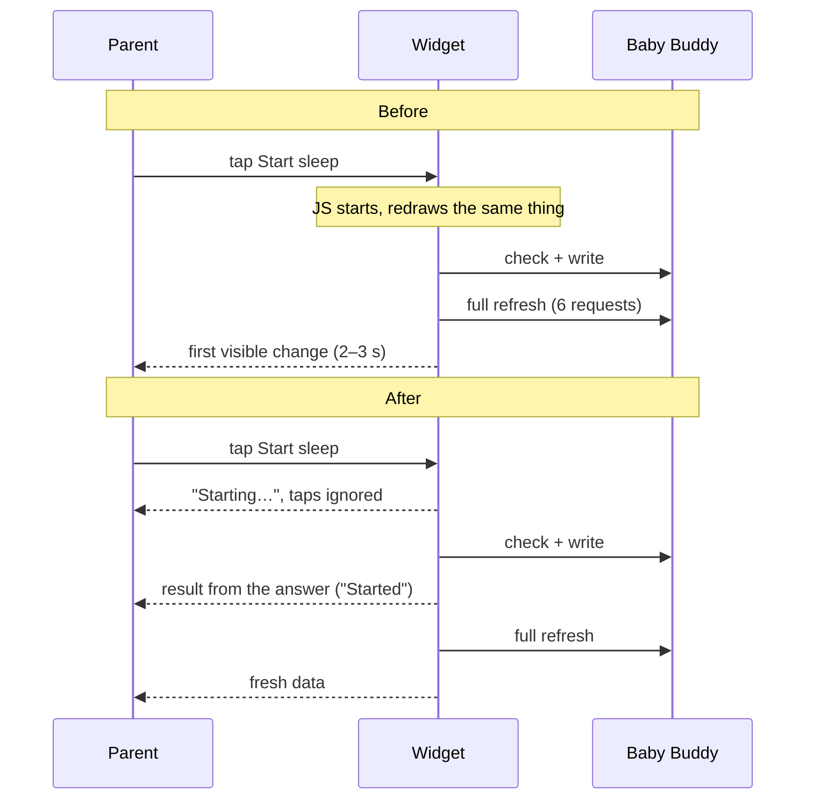
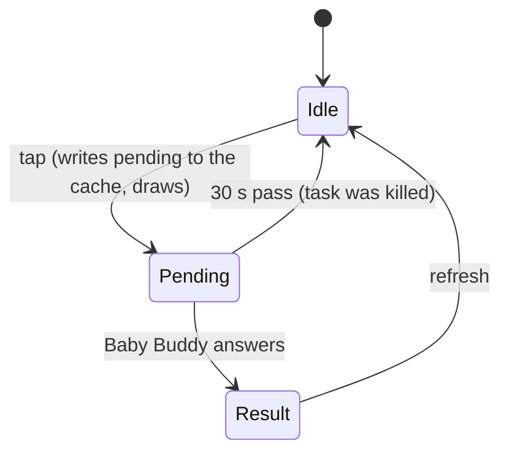
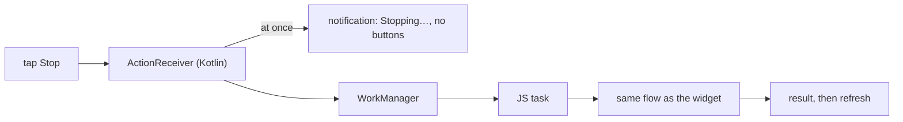

# Tap feedback: the picture

A tap that waits on Baby Buddy **says at once that it was heard**, then shows the result. Pending never guesses the result: only Baby Buddy's answer changes what's shown.

## Before and after, on the widget

Two changes on the widget: a **pending draw** right when JS starts, and the **result drawn from the write's answer** instead of waiting for the refresh.

## Pending lives in the widget cache

- Stored in the cache, not in the running task, so **every widget instance and the lock-screen notification agree**.
- **Expires after 30 s**, so a task killed mid-write can't leave the widget stuck.
- While pending, **taps on buttons are dropped** by the handler. The buttons stay tappable: a widget can't redraw itself when the 30 s run out, so after a killed task, the next tap is what unlocks it.

## What pending looks like

| Tap | Pending label |
| --- | --- |
| Start sleep / Start feeding | `Starting…` |
| Stop sleep | `Stopping…` |
| Left / Right / Bottle / Both (stop feeding) | `Saving…` |
| Wet / Dirty / Both (diaper) | `Logging…` |

The tapped button shows the label, dimmed; the row's other buttons dim. Widgets can't animate, so there's no spinner. The labels are the same in every theme.

## Lock-screen notification

The notification is our own native module, so Kotlin draws the pending line **before JS even starts**: the fastest feedback of the three. The words come from JS when the notification is built, so they match the widget.

## In the app

The dashboard's tracker buttons already change at once (optimistic) and stay as they are. The buttons that still just wait get a shared **pending button**: spinner, pending label, disabled.

- Edit screen `Save` / `Delete` → `Saving…` / `Deleting…` (today a double tap sends twice)
- Adjust-time `Set time` → `Saving…`
- `Connect`, `Load earlier` → same look as the rest
- Anything else the audit finds

## What's left out

- JS start on the widget: until JS runs, nothing can draw. The plan measures how big that share is on the emulator. Whether to add native widget feedback is decided later, after trying it on a physical phone.
- Faster network (fewer requests), optimistic widget results, themed wording.

## Order of work

1. Measure the wait on the emulator.
2. Pending in the widget model (unit TDD).
3. Widget tap flow (emulator).
4. Notification: model (unit TDD) + native pending draw.
5. In-app pending button (Playwright with a slowed server).
6. Wrap up, hand over the physical-phone checklist.
