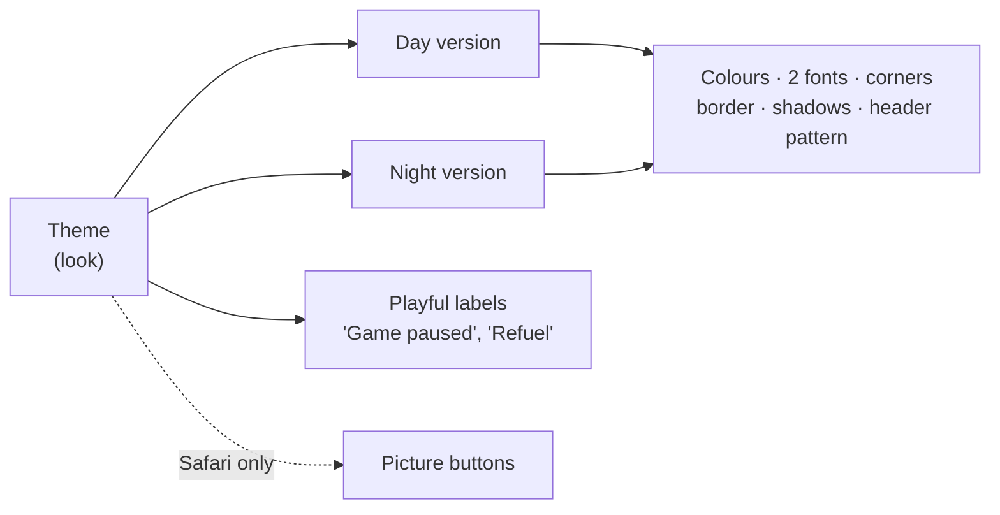
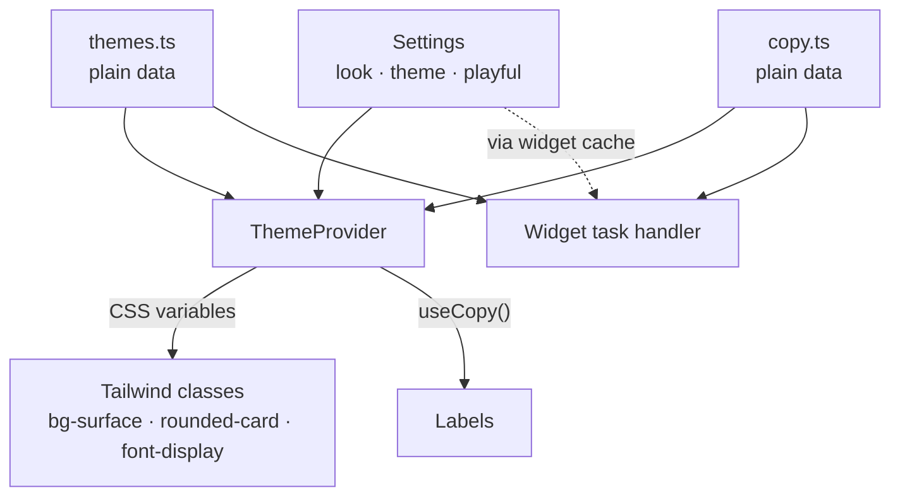
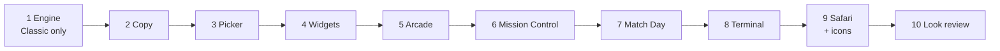

# Themes: the mental model

## In one line

A parent picks one of **six themes** in Settings. A theme changes **how Molly looks and what it calls things**, never what it does. **Molly Classic** is today's app, and it stays the default.

## What a theme is

A theme is a **bundle of values**: colours, a display font and a body font, corner sizes, card borders, shadows and a header pattern, each in a day and a night version. It also has its own **playful labels** and, for Safari only, **icons**.

The screens and components stay the same. They keep using the same classes (`bg-surface`, `rounded-card`, `font-display`), and the theme fills in the values.

## Three independent choices

| Setting | Values | Changes |
|---|---|---|
| `look` (new) | classic · arcade · space · score · term · safari | the whole bundle |
| `theme` (existing, "Colours") | follow the phone · day · night | picks the day or night version |
| `playful` (new) | on (default) · off | playful labels, or plain words with the same look |

All three are per device, stored in `Settings`. The two parents can each pick their own.

## The six themes

| Key | Name | Fonts | Feel |
|---|---|---|---|
| `classic` | Molly Classic | Nunito | today's app |
| `arcade` | Arcade | Pixelify Sans + Space Mono | square corners, hard shadows, checker header |
| `space` | Mission Control | Chakra Petch + IBM Plex Sans | starfield, cool blues |
| `score` | Match Day | Bebas Neue + Barlow | pitch stripes, team colours |
| `term` | Terminal | VT323 + JetBrains Mono | square edges, scanlines, green-screen night |
| `safari` | Safari | Sniglet + Quicksand | picture buttons, leopard spots, fireflies |

The picker groups Safari under "For little ones" and the others under "For grown-ups".

## How a value reaches the screen

`themes.ts` and `copy.ts` are **plain data with no React**, because the widget's task handler runs without a React tree and has to read them directly, as it reads `tokens.ts` today.

The provider turns the chosen theme into **CSS variables**, the same way colours already work. Step 1 first checks that fonts, corners and shadows can also come from variables on Android.

## Where labels change

| Themed (when Playful is on) | Always plain |
|---|---|
| dashboard: header, hero, Today title, tiles, Recent | History, Help, onboarding |
| edit screen: Save, Delete, notes placeholder | error and permission messages |
| Settings title | screen-reader labels |
| widgets | labels the design has no playful version of (`Skip nap`, `Why ›`, next-nap line) |
| toasts that name a tracker | |

Classic's labels are **exactly today's strings**, so choosing Classic, or turning Playful off, gives today's wording.

## What follows the theme, and what doesn't

- **App**: everything, including the header pattern.
- **Widgets**: colours, fonts, corners, labels. **No header pattern.**
- **Lock-screen notification**: stays Classic.

## Build order

Steps 1–4 build the engine with only Classic in it, so nothing changes on screen. Steps 5–9 each add one theme: its values, labels, fonts, header and picker card, then a look check. Safari comes last because it also adds icons.
