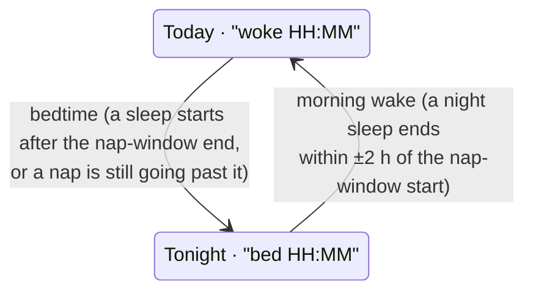
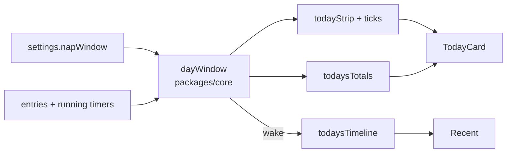

# Today window: mental model

The Today card stops splitting at midnight. It splits where the baby's day actually splits: **morning wake** and **bedtime**.

## The one picture

```
 yesterday                                today                                     tomorrow
 ──────────────┬──────────────────────────┬──────────────────────────┬──────────────────────
     Today     │        Tonight           │        Today             │   Tonight
               │                          │                          │
          bedtime 19:25            morning wake 06:40            bedtime 19:40
               │   night feeds, short     │  naps, feeds, diapers    │
               │   wakes stay in here     │                          │
                                midnight is just a tick on the strip
```

The card is always in exactly one of two states, and it flips only at those two moments.

## Two states, two flips



Passing 19:00 awake does **not** flip to night. Only an actual bedtime does.

## Finding morning wake

Look at sleeps that **aren't naps** (they started outside the nap window) and ended within **±2 h of the nap-window start**. The closest to it wins.

```
nap window start = 07:00       range 05:00 ─────────── 07:00 ─────────── 09:00
night sleep ends 05:10                 ●  (110 min away)
back-to-sleep 06:00–06:40                            ●  (20 min away)  ← wins
morning nap 07:30–08:10                                       ✗ nap, never counts
```

An early wake that goes back to sleep doesn't flip anything. When the back-to-sleep ends, it just becomes the closer wake.

## Finding bedtime

The first sleep after the morning wake that either:

- starts **after** the nap-window end, or
- started as a nap and is **still asleep past** the nap-window end.

The running sleep timer counts, so tapping Start sleep at 19:25 flips the card straight away.

## When nothing is logged: go by the clock

No wake found (new app, or nobody logged the night)? Molly uses the nap window itself.

| Now is… | Card shows |
| --- | --- |
| inside the nap window | Today, from the nap-window start |
| outside it | Tonight, from the last nap-window end |

The same applies if yesterday's wake has no bedtime after it: a day never runs past midnight. With the clock fallback, the subtitle ("woke…" / "bed…") is left out.

## What the strip shows

| | Starts at | Ends at | Ticks |
| --- | --- | --- | --- |
| Today | morning wake | later of nap-window end, now + 30 min | start, every 3rd hour, end |
| Tonight | bedtime | later of next nap-window start, now + 30 min | same |

If a day runs past the nap-window end, a **dashed line** marks where it was.

## What moves off midnight

| Piece | Old start | New start |
| --- | --- | --- |
| Strip lanes | midnight | window start |
| Totals line | midnight | window start (sleep clipped, feeds by start) |
| Recent | midnight | **morning wake**, so at night it still shows the whole day |

## Where it lives



All the logic is pure core functions, recomputed on every render. Changing the nap window in Settings moves the card at once, with nothing stored.
