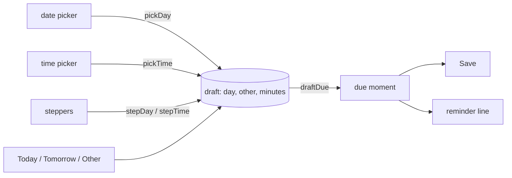
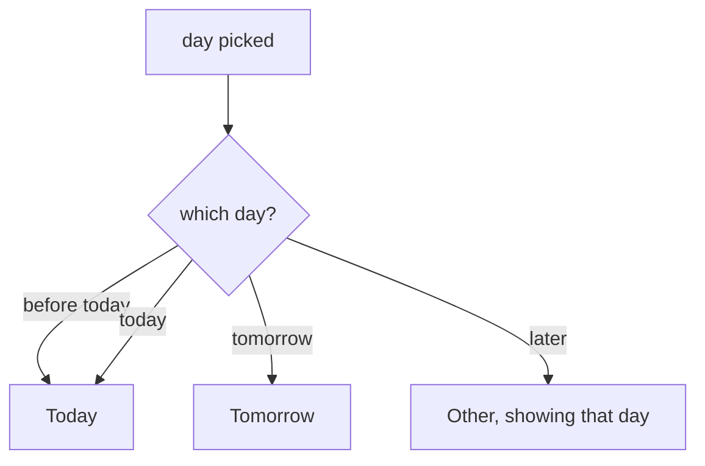
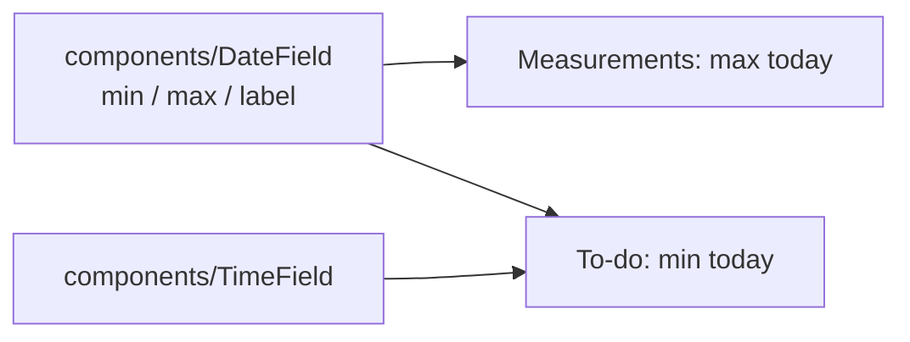

# Mental model: due date and time pickers

## In one sentence

The date and the time in the to-do sheet become tappable: a tap opens the system picker (Android) or the browser's field (web), and whatever is set goes through the same draft as the steppers, which stay for nudges.

## The Date block, before and after

```
Before                               After
[No date][Today][Tomorrow][Other]    [No date][Today][Tomorrow][Other]
28 Oct            [−1 d] [+1 d]      (28 Oct)          [−1 d] [+1 d]    tap → date picker
[Any time][At a time]                [Any time][At a time]
09:00             [−15]  [+15]       (09:00)           [−15]  [+15]     tap → time picker
🔔 This phone reminds you …          🔔 This phone reminds you …
```

Only the two big values change. On web they are the browser's own date and time fields in the same place.

## One draft, three ways in



Pickers and steppers never talk to each other. Both just change the draft, so stepping after a pick starts from the picked value, and the reminder line follows whatever the draft says.

## Picking a day



Only picks snap to Today / Tomorrow. The −1 d / +1 d steppers stay on Other even when they land on tomorrow, so the row under the thumb doesn't disappear.

## Picking a time

- Any minute: 14:40 stays 14:40.
- ±15 steps from there, kept within 00:00–23:59 (not 23:45 any more, so +15 from 23:50 doesn't go back in time).
- Android's clock dialog has a keyboard icon to type the time instead. It opens on the clock; typing is one tap away.

## Cancel and the keyboard

- Cancelling a picker changes nothing.
- Opening a picker closes the text keyboard first. Every other tap in the sheet leaves the keyboard as it was.

## Shared with measurements



The measurements' date field moves to `components/` so both sheets use one. Each field is a pair of files: `.android.tsx` opens the system dialog, `.tsx` is the web input.

## What waits on other work

- Nothing to decide: the six choices in this model (shared field, 23:59, clock first, picks-only snapping, keyboard closing, web inputs) were confirmed on 2026-10-29; `NOTES.md` keeps the alternatives turned down.
- The PR waits for #30's PR (#39). Issue #36 edits the same Date block and expects a rebase.
