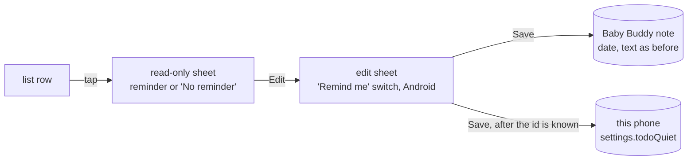
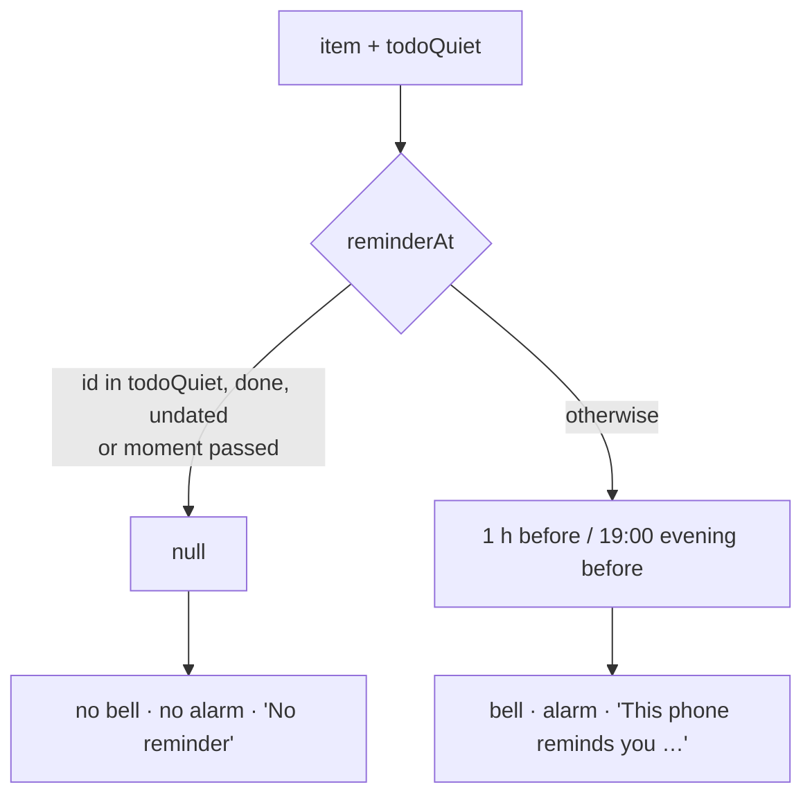
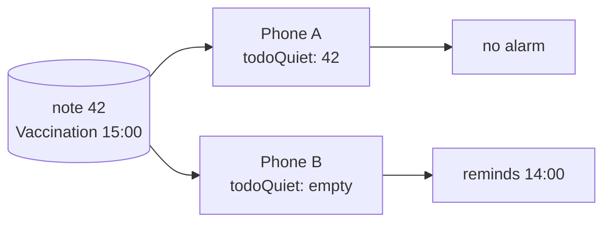

# Mental model: turning off an item's reminder on this phone

## In one line

Each phone keeps a list of to-do ids it won't remind about (`settings.todoQuiet`). The item, its date and the other parent's reminders don't change.

## Where the switch lives

The switch is in the edit sheet only, on Android with a date chosen. It saves with Save, like the date.

## One rule, every place follows

`reminderAt` is the single place that knows about quiet. The bell, both sheets and the alarm schedule all ask it.

## Per phone

Each phone decides for itself. Sign-out or a reinstall forgets the list, so reminders come back on.

## Date first, reminder second

Quiet only means something with a date. Saving with no date takes the id out, so a later date starts with the reminder on. Pruning drops ids of items that are gone or have lost their date; done items stay, so unticking keeps it quiet.

## Web

No reminders on the web, so no switch either. The web never touches a phone's list.
