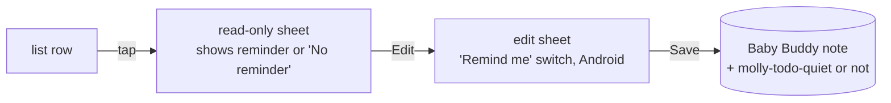
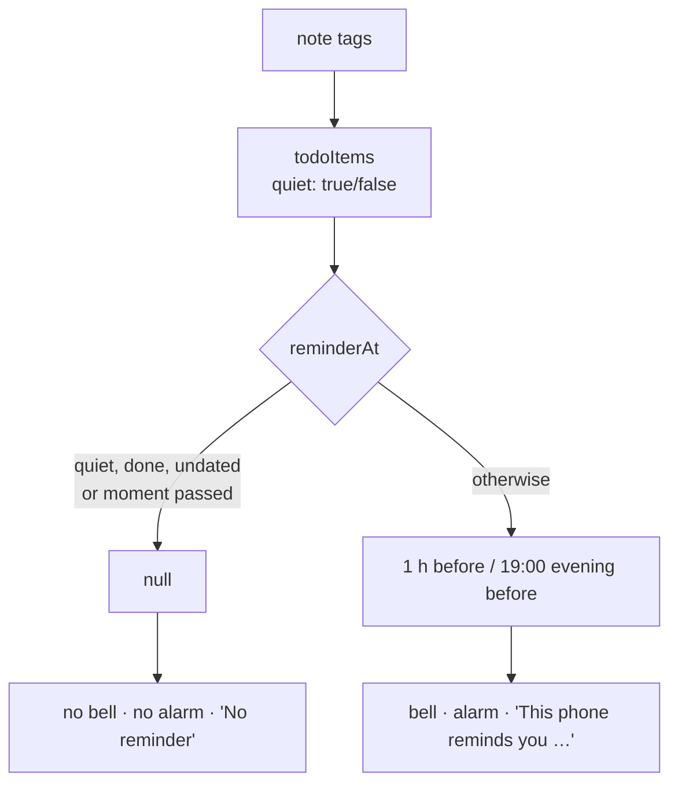

# Mental model: turning off an item's reminder

## In one line

A dated to-do item can carry the tag `molly-todo-quiet`. With it, no phone reminds; the date stays.

## Where the switch lives

The switch is in the edit sheet only, and only on Android with a date chosen. It saves with Save, like the date.

## One rule, every place follows

`reminderAt` is the single place that knows about quiet. The bell, both sheets and the alarm schedule all ask it.

## Shared, not per phone

The tag lives on the note, so both parents' phones read it on their next fetch and drop the alarm. A reminder that already rang is cleared too. Reinstalling changes nothing.

## Date first, reminder second

Quiet only means something with a date. Saving an item with no date drops the tag, so giving it a date later starts with the reminder on. Existing items have no tag, so they keep reminding.

## Web

No reminders on the web, so no switch either. Editing an item on the web keeps its quiet state.

## Still to confirm

Shared vs per phone, both kinds of date, the switch's place and wording, dropping quiet with the date: `NOTES.md` "Decisions to confirm".
