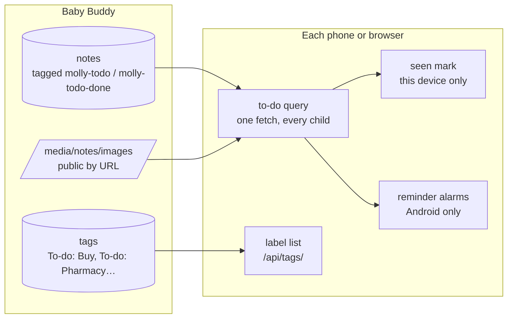
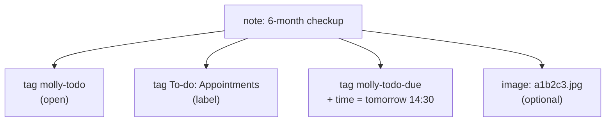
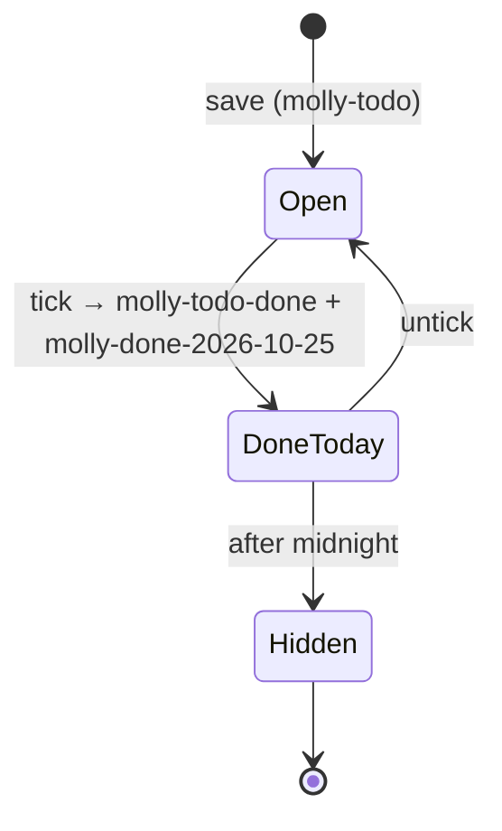
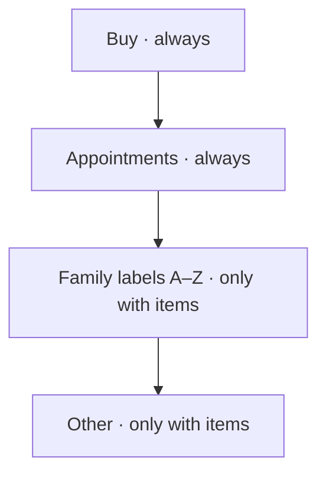
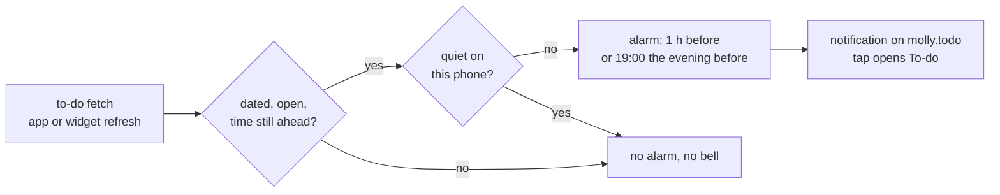

# Mental model: shared to-do list

## In one sentence

Every to-do item is a Baby Buddy note with Molly tags; both phones read the same notes, so both parents see the same list with no backend.

## Where things live

Baby Buddy holds the items, labels and photos. Each phone keeps only two things of its own: which items it has already seen (for "New"), and its reminder alarms.

## One item, as Baby Buddy sees it

- **No label tag** → the item goes under Other.
- **`molly-todo-day`** instead of `molly-todo-due` → a date with no time.
- **Neither** → no date.

## Ticking off and back

Nothing is ever deleted (parents can't delete notes). A tick swaps tags; the date tag says which day, so both phones hide it after the same midnight.

## What the list shows

Inside a card: dated items first, soonest on top ("Tomorrow 14:30", "in 5 days"), then undated ones, newest first. A passed date stays, red, as "overdue" until someone ticks it.

## Labels

- Listed from Baby Buddy's tags (`To-do: …`), which needs the `view_tag` permission. Without it, only Buy and Appointments are offered.
- A new label is created when the item is saved. Typing "pharmacy" reuses "Pharmacy".

## "New" and the badge

*Replaced by [`implan-todo-read-only`](../implan-todo-read-only/MAIN.md): New now lasts until the item is opened on this phone, and Mark unread brings it back.* Each device remembers the highest item id it saw when it last left the list. Higher ids it didn't save itself are "New", and the header's To-do button counts them. Nothing is pushed: the count shows on the next poll.

## Photos

Picked from the camera or library (web: a file), shrunk to 1600 px, saved under a random name. Baby Buddy serves photos without a login, so the random name is what keeps them private. Removing a photo hides it in Molly; the file stays on the server.

## Reminders (Android only)

Each phone sets its own alarms from what it last fetched. When the other parent ticks an item, the next refresh drops the alarm. "Remind me" off in the edit sheet makes an item quiet on that phone only (`settings.todoQuiet`): [`implan-todo-quiet`](../implan-todo-quiet/MAIN.md).

## Build order

1. Notes and tags client → 2. to-do rules (core) → 3. shared alarms and reminder notification → 4. list and header button → 5. add/edit sheet → 6. photos → 7. reminders wired → 8. docs.
