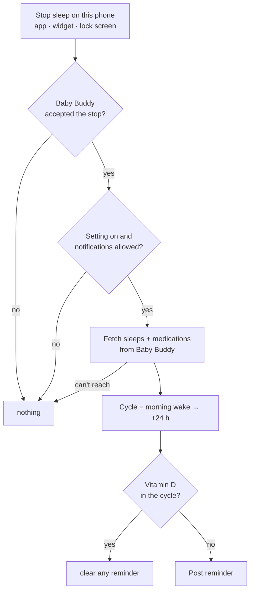
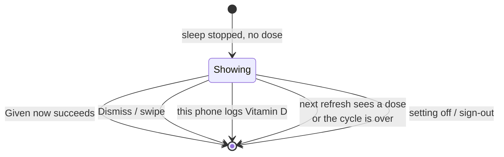

# Vitamin D reminder: mental model

## In one line

Sleep ends on your phone, no Vitamin D yet in the baby's 24-hour cycle → silent notification with **Given now**.

## The flow



The other parent's phone is never involved. Only the phone that stopped the sleep reminds.

## The cycle

```mermaid
gantt
  dateFormat HH:mm
  axisFormat %H:%M
  section Cycle
  07:00 wake → 07:00 next day :07:00, 24h
  section Wake-ups that check
  morning wake :milestone, 07:00, 0m
  nap 1 ends   :milestone, 10:30, 0m
  nap 2 ends   :milestone, 14:45, 0m
  night waking :milestone, 03:10, 0m
```

- Starts at the morning wake `dayWindow` finds. The wake that was just logged counts, so the morning wake starts a new cycle and usually brings the first reminder.
- No wake logged: starts at the nap-window start.
- "Vitamin D" = a name like `Vitamin D`, `Vitamin D3` or `vitamin d 10 µg`, case ignored.

## The notification

```
┌──────────────────────────────────┐
│ Vitamin D not given yet          │
│ Last given yesterday 08:10       │
│ [ Given now ]   [ Dismiss ]      │
└──────────────────────────────────┘
```

- Own channel `molly.reminders`: shows on the lock screen, **no sound**.
- Same plain words and `med` colour in every theme, like the timer notifications.
- **Given now** works like the lock-screen Stop: "Saving…" at once, then logs Vitamin D in Baby Buddy, then goes away (or shows the error with its buttons back).
- **Dismiss** closes it. The next wake-up still checks again.

## When it goes away



A dose logged by the other parent clears it on this phone's next refresh, up to about 30 minutes later.

## The setting

Settings → Notifications → **Vitamin D reminder** On / Off. Off by default, per phone, Android only. Turning it on asks for notification permission if Molly doesn't have it yet.

## Where the code lives

| Piece | Place |
| --- | --- |
| Cycle, name match, "due?" | `packages/core/src/vitamin-d.ts` |
| Notification text | `apps/molly/src/notification/model.ts` |
| Check after Stop, clear on refresh | `src/widget/refresh.ts`, `src/app/(main)/index.tsx` |
| Given now intent | `VITAMIN_D_GIVEN` in `src/widget/model.ts` |
| Channel, show / cancel, buttons | `modules/molly-notify/` (Kotlin) |
